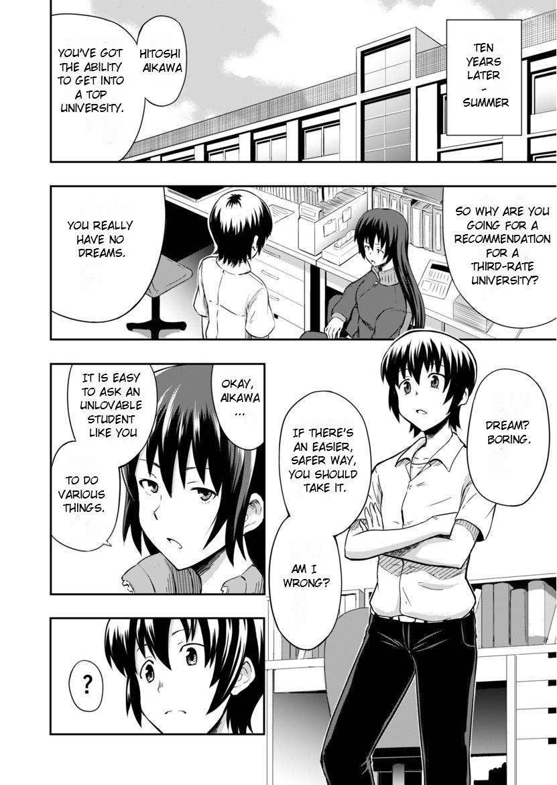

[ImageTrans](https://www.basiccat.org/imagetrans/) is an image translation software which supports all kinds of images. We can use it as a manga translator, as well. 

Here are the steps to translate manga images.

1. Put all the images in a folder.
2. Open ImageTrans and create a new project. You can configure the language pair of the project, like Japanese to English.
3. Import the images in the folder.
4. Use custom model text detection to detect all the text lines.
5. Select a Japanese OCR, like mangaOCR, to extract the text of all the text areas.
6. Merge the text lines to a semantic unit.
7. Select a machine translation engine, like ChatGPT, DeepSeek, Gemini or Google, to translate all the text areas.
8. Check the "Translated" checkbox and you can see the translated image with the original text removed and the translation injected.

You can also do all the steps with one click. ImageTrans has a "template" concept. You can directly create a new project based on a Japanese Manga to English template, which has all the workflow and project settings. Then you can simply batch translate images with one click.

## Example

Original:

{: width="830" height="1170"}

Translated:

{: width="831" height="1170"}

Image source: <https://github.com/mantra-inc/open-mantra-dataset>

## Video Tutorial

<iframe width="560" height="315" src="https://www.youtube.com/embed/y7DyII0_zCk?si=QbFglebKXkB6od79" title="YouTube video player" frameborder="0" allow="accelerometer; autoplay; clipboard-write; encrypted-media; gyroscope; picture-in-picture; web-share" referrerpolicy="strict-origin-when-cross-origin" allowfullscreen></iframe>

## Related

* [How to Learn Japanese by Reading Manga](https://www.basiccat.org/how-to-learn-japanese-by-reading-manga/)
* [The Best Way to Translate manga at present](https://www.basiccat.org/best-practice-manga-ocr-and-translation/)

