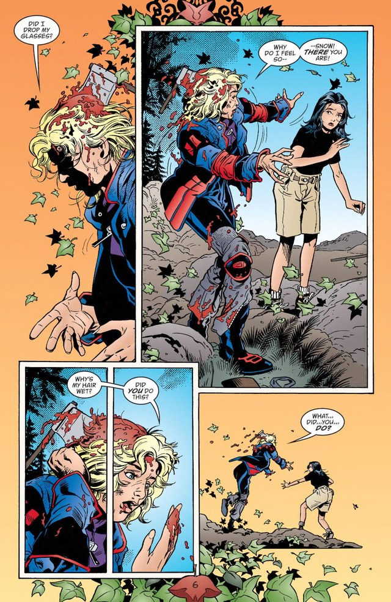
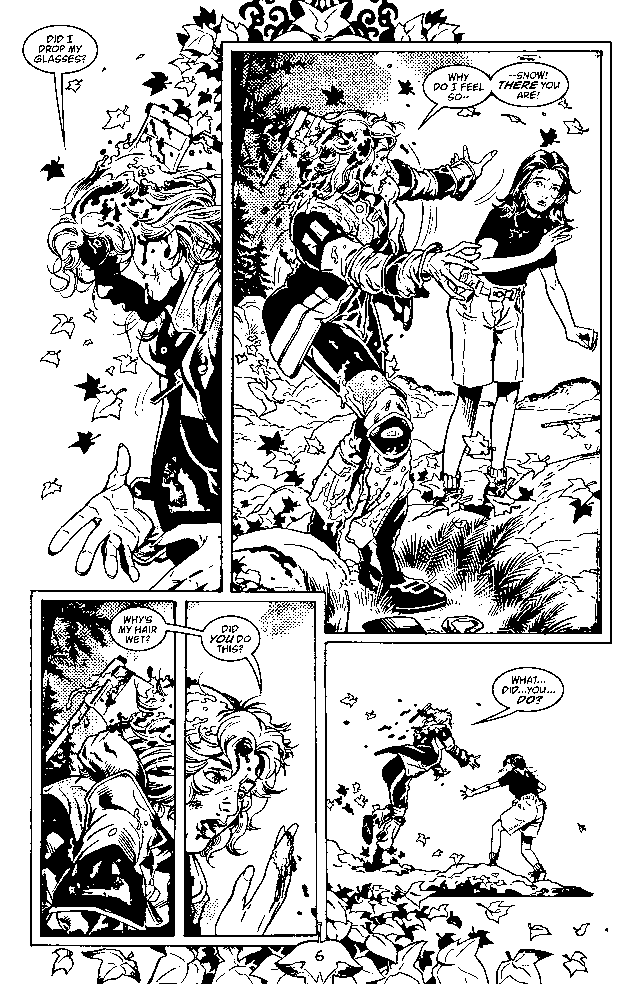
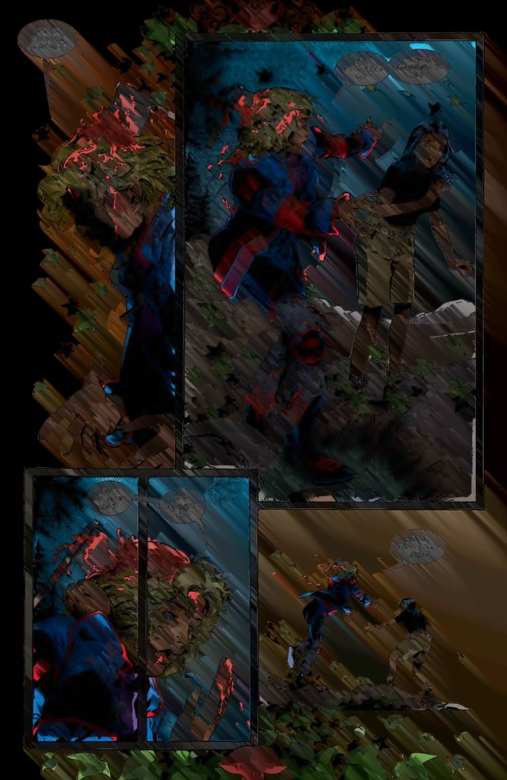
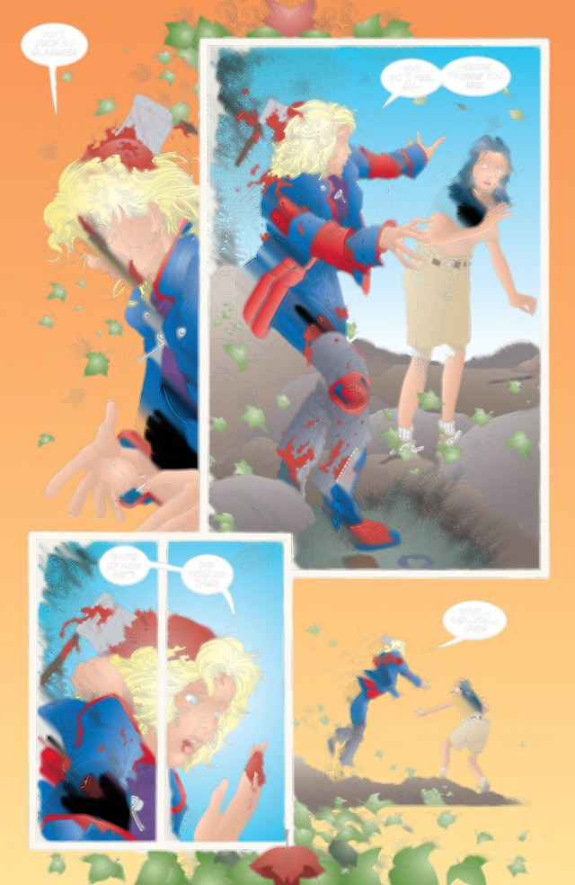
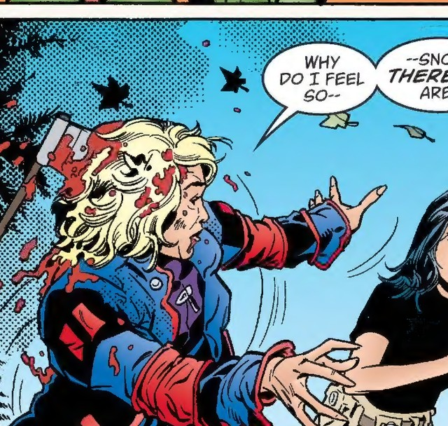

A comic PDF is usually one big image per page. Store it as JPEG and the file is large; convert it to lossy JPEG2000 and the lines and text quickly get blurry. MRC (Mixed Raster Content) offers a middle ground: split each page into three layers — **mask, foreground and background** — compress each one the way that suits it best, and composite them again for display.

Below is a high-quality example using page 6 of *Fables* issue 17 (the image copyright belongs to the original publisher; it is used here only as a technical demo).

<iframe src="/album/mrc-comic/comic-mrc-high.pdf" width="360px" height="553px"></iframe>

[Download the sample PDF](/album/mrc-comic/comic-mrc-high.pdf)

| Item | Size |
| --- | ---: |
| Original JPG | 4,187,164 B (about 4.19 MB) |
| MRC high-quality PDF | 537,927 B (about 525 KB, **about 87% smaller**) |
| ├ Background layer (JPEG2000, 0.20 bpp) | 144,966 B |
| ├ Foreground layer (JPEG2000, 0.40 bpp) | 283,078 B |
| └ Mask (CCITT G4, 1-bit) | 108,608 B |

Rendering the generated PDF at the original pixel size (1919×2950) into a PNG and comparing it pixel by pixel with the original JPG gives a PSNR of **35.45 dB** and an SSIM of **0.9868**. The "original file" here is the roughly 4.19 MB JPG (the image inside the input PDF). The example uses the built-in Java (JAI) JPEG2000 encoder and a G4 mask, with no dependency on external tools such as Kakadu; if `jbig2enc` is installed on the machine, the 1-bit mask can usually be made even smaller.

## How to measure quality: PSNR and SSIM

Both figures above are whole-page metrics comparing "rendered result vs. original image": render the PDF at the original pixel size into a bitmap, then compare pixel by pixel. The PDF contains only one image, so the rendering process itself introduces no font or vector interpolation differences.

**PSNR (peak signal-to-noise ratio)** is based on the mean squared error:

```
MSE = (1/N) × Σ (x_i − y_i)²
PSNR = 10 × log10(255² / MSE)      // 8-bit image
```

It measures how far off the average pixel is, in dB; the higher, the closer to the original. Here PSNR is computed over the three RGB channels. As a rule of thumb (same image, same size), you can read it roughly like this:

- **> 40 dB**: no visible difference in most areas;
- **35–40 dB**: very close overall; slight differences are visible on close inspection when zoomed in;
- **30–35 dB**: most people can see the difference;
- **< 30 dB**: the difference is obvious.

This page is at 35.45 dB, which falls in the "very close overall, with slight coding loss visible when zoomed in" range. PSNR is sensitive to luminance and color errors, but it doesn't fully represent human perception.

**SSIM (structural similarity)** compares luminance, contrast and structure within local windows; it ranges from 0 to 1, where 1 means identical. Here SSIM is computed on the grayscale image. It tracks human judgment of "is the structure still there" better than PSNR does:

- **> 0.99**: practically indistinguishable;
- **0.95–0.99**: very close, with possible subtle local differences;
- **0.90–0.95**: the difference is visible;
- **< 0.90**: the structure starts to be visibly damaged.

This page is at 0.9868, which means the structure of the lines, text and artwork is essentially preserved.

When using these two metrics, keep in mind:

- They are **whole-page statistics**, which dilute local problems. If a small patch of text is blurred, the page's PSNR may still be high, so it's best to look at them together with zoomed-in local comparisons.
- They don't measure "subjective sharpness." The high-quality preset keeps the anti-aliasing gray edges, which gives higher PSNR/SSIM, but it may look less "sharp" than the small preset, which removes those edges. Numbers and perception should be understood separately.
- The "lossless" claim for the high-quality preset refers to **the decomposition itself**: the foreground inside the mask is the original pixel, the background outside the mask is the original pixel, and compositing according to the mask reproduces the original image exactly, pixel for pixel. The 35.45 dB is the result *after* JPEG2000 encoding — the G4 mask is lossless, while the foreground/background JPX is lossy.
- Changing the encoder (Kakadu, OpenJPEG, Grok) or its parameters changes the absolute figures; comparisons are only meaningful under identical settings.

## What the three layers are

<table style="width: 100%; border: none; margin-bottom: 1.5em;">
  <tr>
    <td style="width: 50%; border: none; padding: 4px; vertical-align: top;">
      <figure style="margin: 0;">
        
        <figcaption>Original image</figcaption>
      </figure>
    </td>
    <td style="width: 50%; border: none; padding: 4px; vertical-align: top;">
      <figure style="margin: 0;">
        
        <figcaption>Mask (1-bit, black = ink)</figcaption>
      </figure>
    </td>
  </tr>
  <tr>
    <td style="width: 50%; border: none; padding: 4px; vertical-align: top;">
      <figure style="margin: 0;">
        
        <figcaption>Foreground layer (filled with a solid color outside the mask)</figcaption>
      </figure>
    </td>
    <td style="width: 50%; border: none; padding: 4px; vertical-align: top;">
      <figure style="margin: 0;">
        
        <figcaption>Background layer (text filled in)</figcaption>
      </figure>
    </td>
  </tr>
</table>

The mask at the top right is a 1-bit image where black means "there is ink here (lines and text)"; on this page, about 24.7% of the pixels are classified as ink. The bottom left is the foreground layer: original ink colors are kept inside the mask, and everything outside the mask is filled with nearby ink colors. The bottom right is the background layer: the artwork and paper texture are kept as they are, while the body of the text and lines is "filled in" with the surrounding colors. Some faint edges are still visible in the background — those are the anti-aliasing gray edges of the original image, and they are restored together with the mask edges on display.

Compositing can be written as:

```
display = background + foreground × mask
```

In other words: outside the mask you see the background; inside the mask you see the foreground. At full resolution, the foreground inside the mask is the original image and the background outside the mask is the original image, so **the decomposition step itself is lossless, pixel for pixel**; the size reduction comes from the subsequent encoding of the three layers.

<table style="width: 100%; border: none; margin-bottom: 1.5em;">
  <tr>
    <td style="width: 50%; border: none; padding: 4px; vertical-align: top;">
      <figure style="margin: 0;">
        
        <figcaption>Original image (zoomed detail)</figcaption>
      </figure>
    </td>
    <td style="width: 50%; border: none; padding: 4px; vertical-align: top;">
      <figure style="margin: 0;">
        
        <figcaption>MRC composite (high-quality preset, zoomed detail)</figcaption>
      </figure>
    </td>
  </tr>
</table>

Zoomed in, the artwork and halftone dots are preserved, and the black lines are not smeared by JPEG2000 ringing — because the lines are not in the color layers but in the 1-bit mask, which is compressed losslessly with G4/JBIG2.

## How the layers are separated

The whole pipeline is implemented in [mrc4j](https://github.com/xulihang/mrc4j) using Java + OpenCV, in four steps.

### 1. Generate the mask

First convert the page to grayscale and estimate the noise level; for clean digital pages almost no blur is applied. Then use Sauvola adaptive thresholding: for each pixel, compute the mean `m` and standard deviation `s` in a local window, and the threshold is

```
T = m × (1 + k × (s / R − 1))
```

With `k = 0.34` and `R = 128`, pixels darker than `T` are classified as ink. The window size is determined by DPI — about 75 pixels at 300 dpi; when a PDF image has no DPI information, 300 is assumed. A local threshold adapts to the lightness of the paper and the halftone background, making it more stable than a global threshold.

After binarization, a denoising pass is applied: for each ink pixel, look at its 5×5 neighborhood, and if fewer than 4 of the 24 surrounding pixels are marked, treat it as an isolated noise pixel and remove it; small structures such as dots on letters and punctuation are kept.

### 2. Build the foreground and background

Both the foreground and background are built from the **original image**, just with the mask inverted:

- **Foreground layer**: keep the original pixels inside the mask (the true ink colors), and use "radiative filling" outside the mask. For each pixel outside the mask, take the average color of the marked pixels in its surrounding window, add the already-computed output pixels in the top-left quadrant of the window, and average everything together. This way the ink color spreads from the strokes into the blank areas, and the foreground layer becomes a low-frequency image of "ink plus smooth ink color."
- **Background layer**: invert the mask, keep the original pixels outside the mask (paper and artwork), and fill in the inside with the surrounding paper/image colors. The text and lines thus disappear from the background, but the artwork and paper texture remain.

The filling only affects "the layer you can't see"; the goal is to make both layers large flat areas, so JPEG2000 doesn't need to spend bitrate describing noise and texture. The fill window is 6×6 for the foreground and 20×20 for the background, and details such as border handling and integer division follow the semantics of the reference implementation; the implementation uses sliding windows and prefix sums, giving linear complexity independent of window size.

### 3. Compositing and losslessness

Because the foreground inside the mask holds the original pixels and the background outside the mask holds the original pixels, compositing according to the mask reproduces the original image. You can use `--dump` to export the three layers and verify this yourself: the composite matches the original image pixel for pixel.

### 4. Encode and write back to the PDF

- The mask is 1-bit and is compressed with CCITT G4 (or JBIG2). This kind of encoding is lossless for black-and-white bitmaps, so text and lines stay sharp at any zoom level.
- The foreground and background are color images and are compressed with JPEG2000. The high-quality preset keeps full resolution, with 0.40 bpp for the foreground and 0.20 bpp for the background.
- In the PDF, draw the background first, then draw the foreground with the mask as its `/SMask`. The original PDF's text layer (if any) is unaffected and can still be selected, copied and searched.

## Why it suits comics

1. **Lines don't suffer from lossy compression.** The most important visual elements of a comic are the black lines and the speech-bubble text. Putting them in a 1-bit mask, instead of compressing them together with the artwork as JPEG2000, keeps their edges from being damaged by ringing and blocky artifacts.
2. **The color layers become much easier to compress.** The hidden regions of the foreground and background are flat fills, which JPEG2000 can describe at a very low bitrate; the real detail is concentrated only around the mask edges and in the artwork.
3. **The size savings are large.** This page goes from 4.19 MB to 525 KB, with almost no visible loss when zoomed in.
4. **It's compatible with double-layer PDFs.** MRC only replaces the image objects on the page and leaves the existing text layer intact; combined with OCR to generate a hidden text layer, you can also get "small + searchable" comic PDFs.

## Costs and caveats

- The mask is binary, so the original image's anti-aliasing gray edges can only go to one side or the other. When the low-quality preset downsamples the color layers, the gray edges in the background may be averaged into a ring of pale halo; mrc4j's small preset additionally clears the text edges in the background to avoid this halo, at the cost of slightly "harder" edges.
- The higher the mask coverage, the smaller the gains. This page has 24.7% ink; for pages with large black areas or photos, the mask becomes large, and a more photo-oriented preset is a better fit.
- PDF readers need JPEG2000 support (the vast majority have it); the mask uses G4/JBIG2, whose compatibility is fine too.
- Sauvola's window depends on DPI. When compressing image-only PDFs, if there is no DPI metadata, you can specify it with `--dpi`; otherwise 300 is assumed.

## Try it yourself

```bash
java -cp target/mrc4j-1.0-SNAPSHOT.jar com.xulihang.mrc4j.PdfCompressor \
    comic.pdf comic-mrc.pdf --encoder java --no-jbig2 --preset high
```

Add `--dump out/dump` to export the mask, foreground and background for comparison; `--preset small` is the smaller-size preset at 1/3 resolution. The code is at [xulihang/mrc4j](https://github.com/xulihang/mrc4j).

You can also try it right in your browser with the [MRC composite preview tool](/tools/mrc-composite.html). Drag in the background, foreground and mask images, and you'll see the composite result and can download it as a PNG — all processing happens locally.

MRC is not a new format, but it explicitly separates "what is a line and what is artwork" into different layers, letting each kind of content use the compression method that suits it best. For comic pages made of "line art + flat colors + text," the result is especially pronounced.

## Using it in ImageTrans

This MRC decomposition and encoding pipeline has been integrated into [ImageTrans](/imagetrans/): when exporting to PDF, you can choose layered compression, encoding the background, foreground and mask separately. It isn't limited to comics — color documents, scanned book pages and magazine pages can be processed the same way.

You can choose the compression preset according to your purpose:

| Use case | Recommended preset | Goal |
| --- | --- | --- |
| Comics, art books | High-quality compression | **Keep the image resolution unchanged**, prioritize preserving lines, halftone dots, artwork and text detail |
| Text-heavy documents where illustrations aren't important | Low-quality compression | Allow reducing the color layers' resolution to compress the size as much as possible |

With the same MRC pipeline, you can choose between "quality first" and "size first": pick high-quality compression for comics, and low-quality compression for other, mainly text-oriented material when you want to squeeze the size as much as possible.
