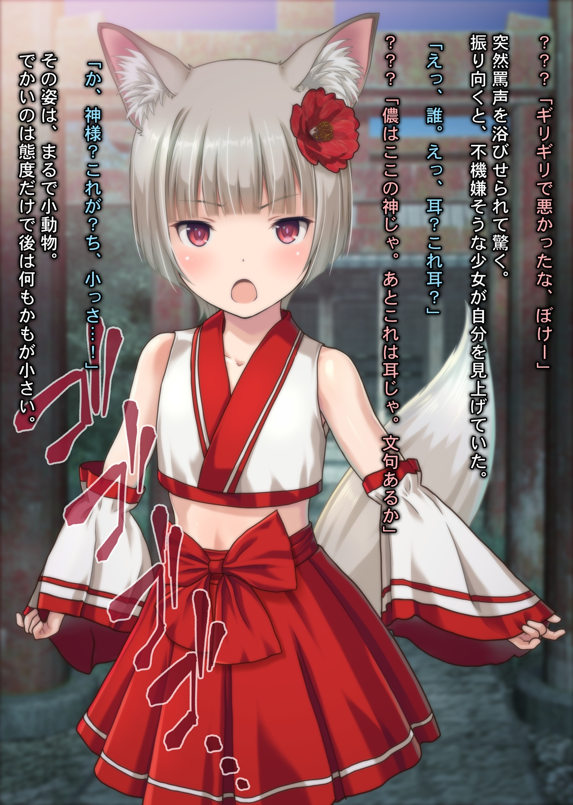
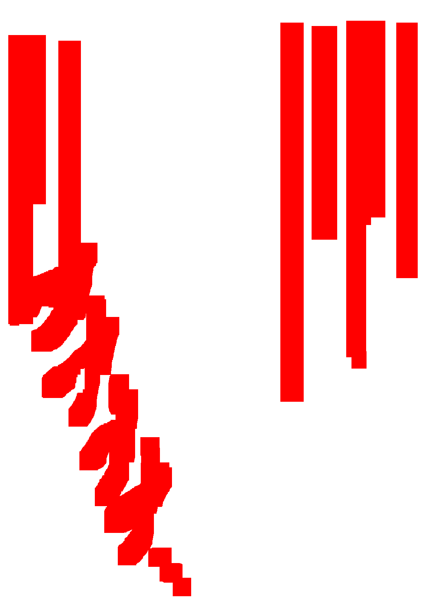
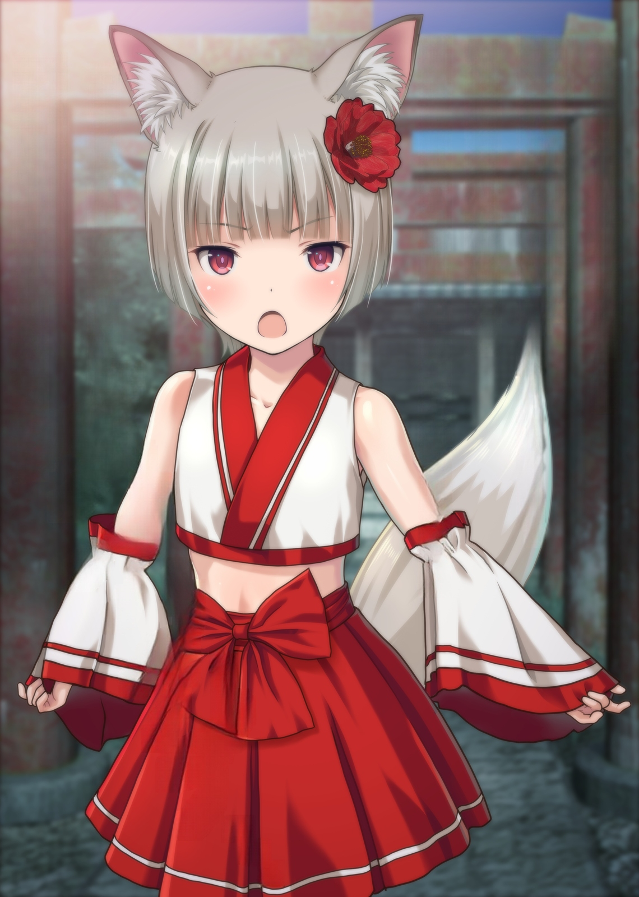
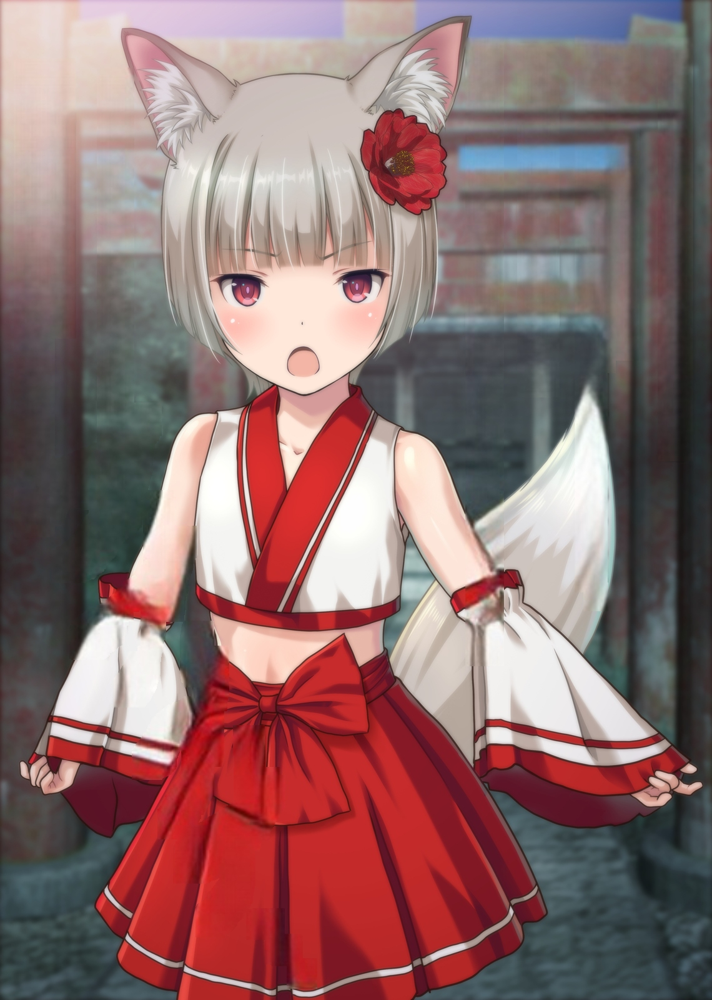

Image inpainting is a way of removing target content from an image based on a mask. Here is an example:

Original image:

Mask:

Image with text removed:

The common approaches include traditional image processing methods such as OpenCV Telea and PatchMatch, and deep learning models such as LaMa and MIGAN. There are also generative models, such as Stable Diffusion Inpaint and Gemini Nano Banana.

Deep learning models, however, usually have constraints on the input and output images. For example, the MIGAN model internally shrinks the image to 512x512. LaMa supports dynamic sizes, but if the image is too large, processing takes a long time, memory usage is high, and the image may actually lose detail.

Below is the result using a fixed 512x512 output size, where only the masked area has been replaced with text-removed content. You can see a clear loss of quality. And because the detail is missing, running a super-resolution model such as RealESRGAN on it doesn't help much either.

If the image resolution isn't very high, you can use the dynamic-size version directly and get good results. But with very high resolutions, the results are poor. To handle high-resolution HD images, the only workable approach at present is a sliding window: use, say, 960x960 as one processing window, sweep across the whole image, and end up with an HD result. Compared with processing the original image directly, it may lack full-image context and be less coherent as a whole, but generally, with a suitable window size, the results are decent — and much sharper. One problem with the sliding window is that seams can appear, which needs a little optimization: each window's inpainted result is used only at its masked pixels, and is blended with the existing image by a weighted average using a "gradient weight based on distance from the window edge" — that is, weight 1 at the window center, approaching 0 at the edges (the linear rampX/rampY gradients plus the accumulated weightMat in mergeWindow), so that the overlapping areas of adjacent windows transition smoothly instead of being hard-stitched. The final result gives the text-removed image shown in the example above.

Of course, if the creator of such CG art provides a text-free original image, you can just use that and save yourself all this trouble.

[ImageTrans](/imagetrans/) supports this kind of high-resolution inpainting, and can also use a text-free version of an image directly, for tasks such as comic translation.

Image source: <https://www.dlsite.com/maniax/work/=/product_id/RJ271648.html/>
