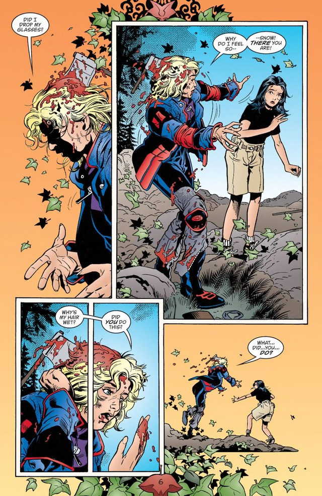
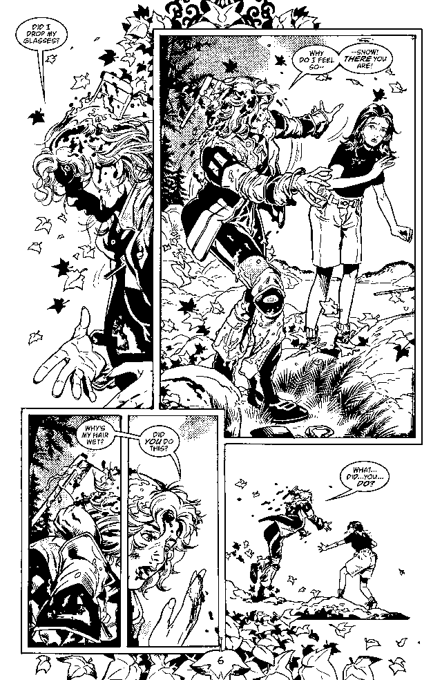
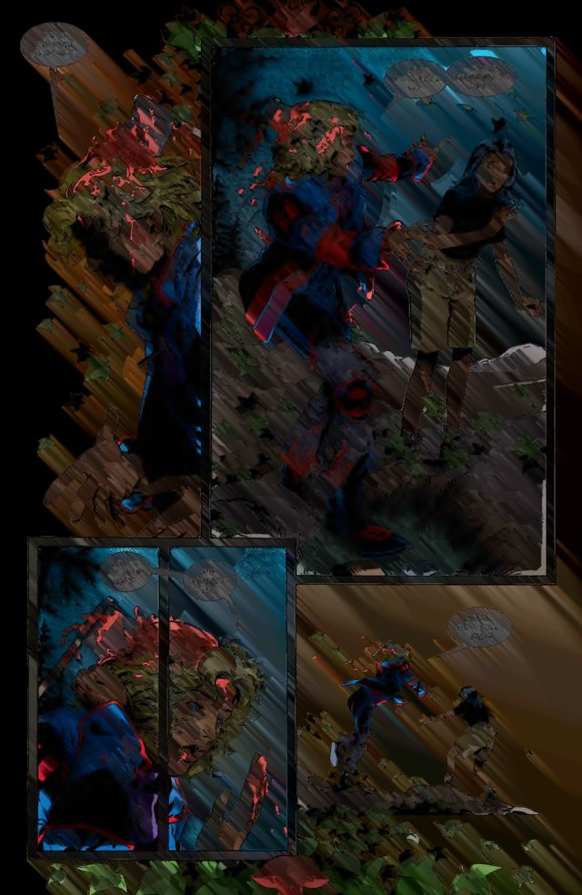
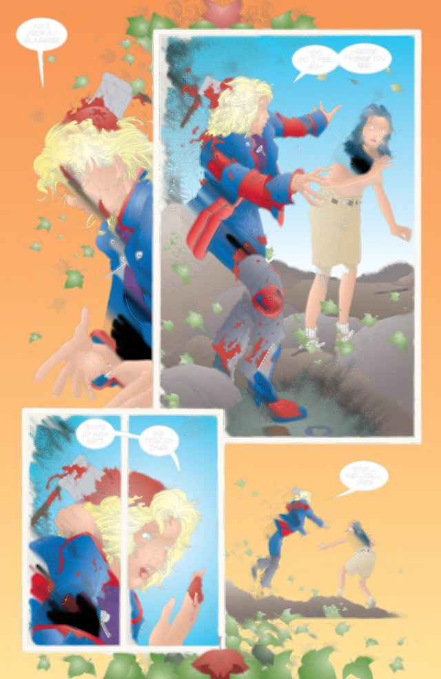
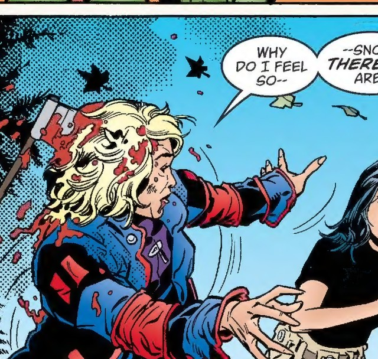

漫画 PDF 通常是一页一张大图。直接存 JPEG，体积大；直接转成有损的 JPEG2000，线条和文字又容易糊。MRC（Mixed Raster Content）提供了一个折中：把一页拆成**掩膜、前景、背景**三层，分别用最适合的方式压缩，再在显示时合成。

下面用《Fables》第 17 期第 6 页做一个高质量档的示例（图片版权归原出版方，这里仅用于技术演示）。

<iframe src="/album/mrc-comic/comic-mrc-high.pdf" width="360px" height="553px"></iframe>

[下载示例 PDF](/album/mrc-comic/comic-mrc-high.pdf)

| 项目 | 体积 |
| --- | ---: |
| 原始 JPG | 4,187,164 B（约 4.19 MB） |
| MRC high 档 PDF | 537,927 B（约 525 KB，**减少约 87%**） |
| ├ 背景层（JPEG2000，0.20 bpp） | 144,966 B |
| ├ 前景层（JPEG2000，0.40 bpp） | 283,078 B |
| └ 掩膜（CCITT G4，1-bit） | 108,608 B |

与原图逐像素比较：PSNR **35.45 dB**、SSIM **0.9868**。这是用内置的 Java（JAI）JPEG2000 编码器和 G4 掩膜跑出来的，没有依赖 Kakadu 等外部工具；如果机器上装了 `jbig2enc`，1-bit 掩膜还能更小。

## 三层分别是什么

<table style="width: 100%; border: none; margin-bottom: 1.5em;">
  <tr>
    <td style="width: 50%; border: none; padding: 4px; vertical-align: top;">
      <figure style="margin: 0;">
        
        <figcaption>原图</figcaption>
      </figure>
    </td>
    <td style="width: 50%; border: none; padding: 4px; vertical-align: top;">
      <figure style="margin: 0;">
        
        <figcaption>掩膜（1-bit，黑色为墨迹）</figcaption>
      </figure>
    </td>
  </tr>
  <tr>
    <td style="width: 50%; border: none; padding: 4px; vertical-align: top;">
      <figure style="margin: 0;">
        
        <figcaption>前景层（掩膜外为填充色）</figcaption>
      </figure>
    </td>
    <td style="width: 50%; border: none; padding: 4px; vertical-align: top;">
      <figure style="margin: 0;">
        
        <figcaption>背景层（文字被填平）</figcaption>
      </figure>
    </td>
  </tr>
</table>

右上角的掩膜是一张 1-bit 图，黑色表示“这里有墨迹（线条和文字）”，这一页大约 24.7% 的像素被判为墨迹。左下角是前景层：掩膜内保留原始墨色，掩膜外被附近墨色填满。右下角是背景层：彩画和纸纹原样保留，文字和线条的主体被周围的颜色“填平”；背景里仍能看到一些很淡的边缘，那是原图的抗锯齿灰边，显示时会和掩膜边缘一起还原原图。

合成方式可以写成：

```
显示结果 = 背景层 + 前景层 × 掩膜
```

也就是说：掩膜外看背景，掩膜内看前景。全分辨率下，前景在掩膜内是原图、背景在掩膜外是原图，所以**分解这一步本身是逐像素无损的**；体积下降来自后面针对三层的编码。

<table style="width: 100%; border: none; margin-bottom: 1.5em;">
  <tr>
    <td style="width: 50%; border: none; padding: 4px; vertical-align: top;">
      <figure style="margin: 0;">
        
        <figcaption>原图（局部放大）</figcaption>
      </figure>
    </td>
    <td style="width: 50%; border: none; padding: 4px; vertical-align: top;">
      <figure style="margin: 0;">
        
        <figcaption>MRC 合成（high 档，局部放大）</figcaption>
      </figure>
    </td>
  </tr>
</table>

放大看，彩画和网点保留了，黑线也没有被 JPEG2000 的振铃糊掉——因为线条不在彩色层里，而在用 G4/JBIG2 无损压缩的 1-bit 掩膜里。

## 怎么分离出来的

整个流程在 Java + OpenCV 实现的 [mrc4j](https://github.com/xulihang/mrc4j) 里完成，分四步。

### 1. 生成掩膜

先把页面转灰度，估计噪声水平；干净的电子稿几乎不做模糊。然后用 Sauvola 自适应阈值：对每个像素，在局部窗口里算均值 `m` 和标准差 `s`，阈值是

```
T = m × (1 + k × (s / R − 1))
```

取 `k = 0.34`、`R = 128`，比 `T` 暗的像素判为墨迹。窗口大小由 DPI 决定，300 dpi 时约 75 像素；PDF 图片没有 DPI 信息时按 300 兜底。局部阈值能适应纸张明暗和网点背景，比全局阈值稳。

二值化之后还会做一次去噪：对每个墨迹像素看它的 5×5 邻域，如果周围 24 个像素里被标记的少于 4 个，就当作孤立噪点去掉；字母上的点、标点这类小结构会保留。

### 2. 构建前景和背景

前景和背景用的都是**原图**，只是掩膜相反：

- **前景层**：掩膜内保留原像素（墨迹的真实颜色），掩膜外用“辐射式填充”。对每个掩膜外像素，取它周围窗口里被标记像素的平均色，再加上窗口左上象限里已经算好的输出像素，一起求平均。这样墨色会从线条向空白处扩散，前景层变成“墨迹 + 平滑墨色”的低频图。
- **背景层**：把掩膜反过来，掩膜外（纸和彩画）保留原像素，掩膜内用周围纸色/画面颜色填平。于是文字和线条从背景里消失，但彩画和纸张纹理还在。

填充只影响“看不见的那一层”，目的是让两层都变成大片平坦区域，JPEG2000 编码时不需要花码率去描述噪点和纹理。填充窗口在前景里用 6×6，背景里用 20×20，边界、整数除法等细节都保留了参考实现的语义；实现上用滑动窗口和前缀和，复杂度是线性的，与窗口大小无关。

### 3. 合成与无损性

因为前景在掩膜内是原像素、背景在掩膜外是原像素，按掩膜合成后就是原图。可以用 `--dump` 导出三层自行验证：合成图与原图逐像素一致。

### 4. 编码并写回 PDF

- 掩膜是 1-bit，用 CCITT G4（或 JBIG2）压缩。这类编码对黑白位图是无损的，所以文字和线条在任何缩放级别都保持锐利。
- 前景、背景是彩色图，用 JPEG2000 压缩。高质量档保持全分辨率，前景 0.40 bpp、背景 0.20 bpp。
- 在 PDF 里先画背景，再把前景连同掩膜作为 `/SMask` 画上去。原 PDF 的文字层（如果有）不受影响，仍然可以选择、复制和搜索。

## 为什么适合漫画

1. **线条不吃有损压缩的亏**。漫画最重要的视觉元素是黑线、气泡文字。把它们放进 1-bit 掩膜，而不是和彩画一起压 JPEG2000，边缘不会被振铃和色块破坏。
2. **彩色层变得非常好压**。前景和背景里被隐藏的区域都是平坦填充，JPEG2000 用很低的码率就能描述；真正的细节只集中在掩膜边缘和彩画上。
3. **体积收益大**。这一页从 4.19 MB 降到 525 KB，放大看几乎没有可见损失。
4. **和双层 PDF 兼容**。MRC 只替换页面里的图像对象，原有文字层保留；如果配合 OCR 生成隐藏文字层，还能得到“体积小 + 可搜索”的漫画 PDF。

## 代价和注意点

- 掩膜是二值的，原图的抗锯齿灰边只能归到某一侧。低质量档把彩色层降采样时，背景里的灰边可能被平均成一圈浅色光晕；mrc4j 在小图档会把背景的文字边缘额外清掉，避免这种光晕，代价是边缘会更“硬”一点。
- 掩膜覆盖率越高，收益越小。这一页 24.7% 是墨迹；如果是大面积黑底或照片类页面，掩膜会变得很大，适合改用偏照片的预设。
- PDF 阅读器需要支持 JPEG2000（绝大多数都支持）；掩膜用 G4/JBIG2，兼容性也没问题。
- Sauvola 的窗口依赖 DPI。给纯图片 PDF 压缩时，如果没有 DPI 元数据，可以用 `--dpi` 指定，否则会按 300 计算。

## 自己试一下

```bash
java -cp target/mrc4j-1.0-SNAPSHOT.jar com.xulihang.mrc4j.PdfCompressor \
    comic.pdf comic-mrc.pdf --encoder java --no-jbig2 --preset high
```

加 `--dump out/dump` 可以把掩膜、前景、背景导出来对照；`--preset small` 则是 1/3 分辨率的小体积档。代码在 [xulihang/mrc4j](https://github.com/xulihang/mrc4j)。

MRC 不是什么新格式，但它把“哪里是线条、哪里是画面”这个信息显式地拆了出来，让每一种内容都用自己最合适的压缩方式。对漫画这种“线稿 + 平涂 + 文字”的页面，效果尤其明显。
