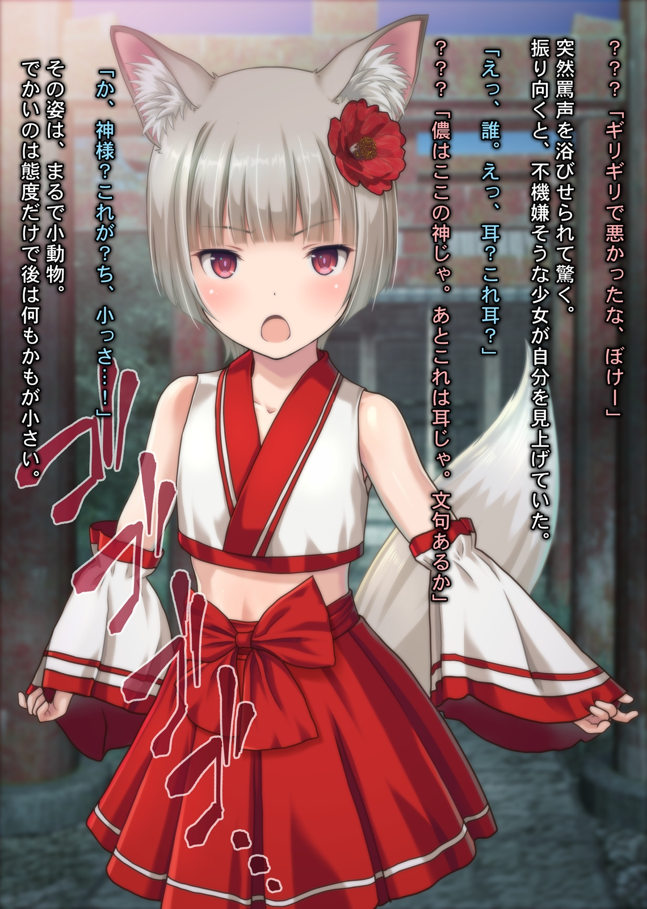
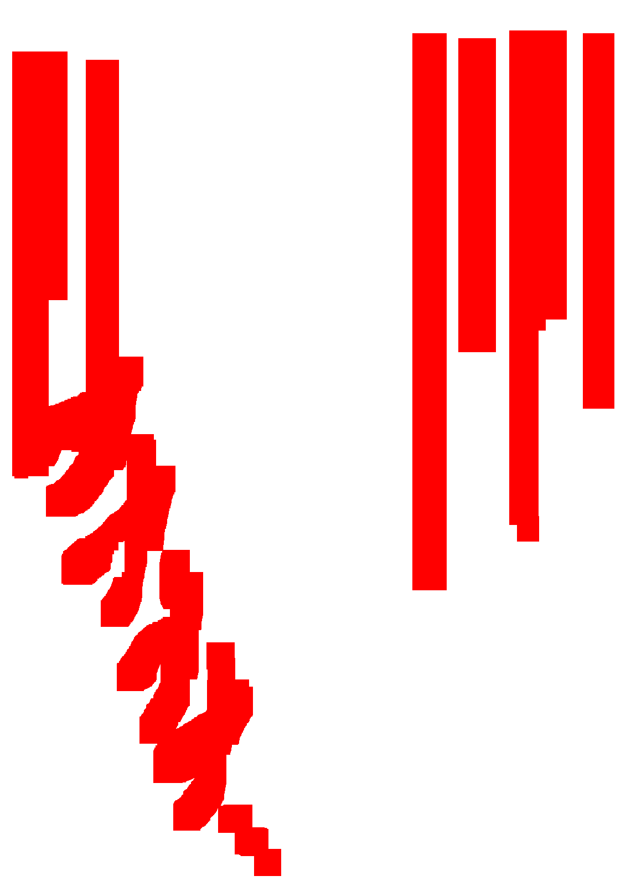

图像修复，是一种基于掩膜去除目标内容的图像处理方法。例如下面的示例：

原图：

掩膜：

去文字图：

常见的有OpenCV Telea、PatchMatch等传统图像处理方式，Lama、MIGAN等基于深度学习的模型。另外也有生成式模型，比如Stable Diffusion Inpaint、Gemini Nano Banana等。

但深度学习模型，通常对输入输出的图像有限制。比如MIGAN模型内部会把图像缩小成512x512，Lama虽然支持动态尺寸，但如果图像尺寸过大，不但处理耗时长、内存占用高，而且反而可能失去图像细节。

下面是使用固定512x512尺寸输出的结果，只替换了掩膜部分的内容为去文字图，可以看到质量有明显损失。并且因为细节缺损，再用RealESRGAN等超分辨率模型，效果也不见得很好。

如果图片分辨率不算高，可以直接用动态尺寸版本得到不错的结果。但分辨率很高，效果就不好。为了能够处理高分辨率的高清图，目前看来，只有使用滑动窗口方式，以比如960x960为一个处理窗口，遍历整个图像，最终得到一个高清的版本。和直接处理原图相比，可能对缺少整图上下文，整体性较差，但一般窗口大小合适，效果还可以，而且修复的结果会清楚很多。滑动窗口的一个问题，是可能存在接缝，需要做点优化：每个窗口的修复结果只在其掩码像素处，按“距离窗口边缘的渐变权重”与已有图像做加权平均融合——即窗口中心权重为1、边缘权重趋近0（mergeWindow 中的 rampX/rampY 线性渐变 + 累积权重 weightMat），使相邻窗口的重叠区域平滑过渡，而非硬拼接。最终可以得到示例图中的去文字结果。

不过如果这种CG图的作者有提供无文字原图，可以直接使用，就不用这么麻烦了。

[ImageTrans](/zh/imagetrans/)支持这样的高分辨率图像修复，并且支持直接使用图片的无文字图，用于漫画翻译等任务。

图片来源：<https://www.dlsite.com/maniax/work/=/product_id/RJ271648.html/>
