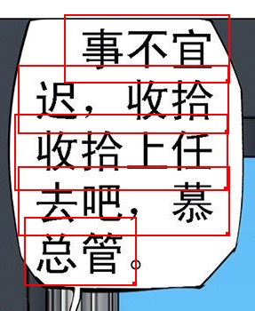
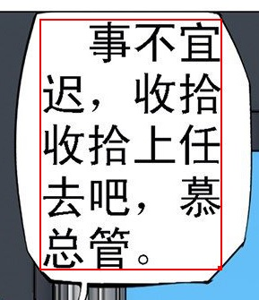

Hier finden Sie eine Zusammenstellung häufig gestellter Fragen zu ImageTrans. Weitere Fragen können Sie [hier](https://github.com/xulihang/ImageTrans-docs/issues) durchsuchen.

1. Welche Sprachen unterstützt die Software?

    Die Software selbst unterstützt alle Sprachen. Die Einschränkungen liegen hauptsächlich bei der OCR und der maschinellen Übersetzung.

    Im Folgenden finden Sie Seiten, auf denen die Sprachen beschrieben werden, die einige der von ImageTrans verwendeten OCR- und maschinellen Übersetzungsdienste unterstützen:

    * <https://tesseract-ocr.github.io/tessdoc/Data-Files-in-different-versions.html>
    * <https://cloud.google.com/vision/docs/languages>
    * <https://cloud.google.com/translate/docs/languages>

2. Wird vertikales Japanisch unterstützt?

    Youdao, Baidu, Google, mangaOCR, tesseract und die in Windows 10 integrierte OCR können vertikales Japanisch erkennen. ImageTrans bietet außerdem die Funktion, vertikale Bilder in horizontale umzuwandeln, damit auch OCR-Engines, die nur horizontales Japanisch erkennen, vertikales Japanisch erkennen können.

3. Worin unterscheidet sich die Version für die private Nutzung von der Version für die kommerzielle Nutzung?

    Derzeit gibt es zwischen beiden keine funktionalen Unterschiede. Die Version für die kommerzielle Nutzung richtet sich hauptsächlich an Unternehmen, die sie für kommerzielle Übersetzungsarbeiten einsetzen; nach dem Kauf kann sie auf 5 Geräten verwendet werden.

4. Ist dieser Preis eine monatliche Gebühr oder ein einmaliger Kaufpreis?

    Die erworbene Version kann lebenslang verwendet werden und umfasst kostenlose Updates für ein halbes Jahr.

5. Auf welchen Plattformen läuft die Software? Wird Linux unterstützt?

    ImageTrans ist eine plattformübergreifende Anwendung, die mit JavaFX entwickelt wurde und unter Windows, macOS und Linux läuft. Die Software hängt von OpenCV ab, deshalb werden eigens Laufzeitbibliotheken für Windows, macOS und Linux bereitgestellt.

6. Warum ist das Ergebnis der maschinellen Übersetzung mit dem Ausgangstext identisch?

    Zunächst müssen Sie in den Projekteinstellungen das Sprachpaar für die Übersetzung festlegen.

7. Was sind OCR- und maschinelle Übersetzungs-APIs? Wie beantragt man sie?

    API ist die Abkürzung für „Application Programming Interface“ (Anwendungsprogrammierschnittstelle). Unternehmen wie Google und Microsoft stellen ihre OCR- und maschinellen Übersetzungstechnologien in Form von APIs bereit, damit Drittanwendungen sie aufrufen können. ImageTrans integriert gängige OCR- und maschinelle Übersetzungs-APIs. Für den Aufruf dieser APIs ist in der Regel ein API-Schlüssel erforderlich. Die genaue Vorgehensweise entnehmen Sie bitte der Dokumentation der jeweiligen Plattform.

    Im Folgenden finden Sie eine Anleitung, die ich im Internet gefunden habe, zum Beantragen eines API-Schlüssels für die OCR von Google Vision:

    <https://easyscreenocr.com/how-to-load-google-api-in-easyscreenocr-for-mac-lifetime-version/>

8. Welche OCR- und maschinellen Übersetzungsdienste unterstützt die Software?

    Im Folgenden finden Sie eine Liste der derzeit unterstützten Online-Dienste

    OCR: Baidu, Youdao, Tencent, Google, Microsoft Azure, OCRSPACE, ABBYY Cloud, Clova

    Maschinelle Übersetzung: Baidu, Youdao, Tencent, Niutrans, Google, Microsoft, Colorful Clouds, Cloudtranslation, Papago

    ImageTrans enthält standardmäßig die Schlüssel für OCR-Dienste wie Baidu, Azure und OCRSPACE sowie die Schlüssel für maschinelle Übersetzungsdienste wie Baidu, Tencent und Niutrans.

    Darüber hinaus werden auch Offline-OCR und Offline-Maschinelle Übersetzung unterstützt; siehe die nächste Frage.

9. Kann die Software offline verwendet werden?

    Die Software kann offline verwendet werden. Beim ersten Start ist jedoch eine Internetverbindung erforderlich, um zu prüfen, ob ein Kauf vorliegt; der Eintrag wird 7 Tage lang gespeichert.
    
    Die Software kann Bilder offline übersetzen und unterstützt Offline-OCR und Offline-Maschinelle Übersetzung.

    Offline-OCR: tesseract, mangaOCR, in Windows 10 integrierte OCR, PaddleOCR, EasyOCR

    Offline-Maschinelle Übersetzung: OPUS-CAT, eztrans, Sugoi
    
    Online-OCR und Online-Maschinelle Übersetzung, insbesondere die maschinelle Übersetzung, liefern oft bessere Ergebnisse und decken mehr Sprachen ab, bringen aber auch Probleme mit sich, etwa die Notwendigkeit einer Internetverbindung und Beschränkungen bei den Anfragen.

10. Warum bleiben bei der Batch-Verarbeitung von OCR und maschineller Übersetzung manche Rahmen ohne Ergebnis?

    Online-OCR- und maschinelle Übersetzungsdienste haben Beschränkungen bei den Anfragen, zum Beispiel nur 5 Anfragen pro Sekunde. ImageTrans ermöglicht es, das Zeitintervall zwischen OCR- und Übersetzungsanfragen festzulegen, um dieses Problem zu vermeiden.

    Wenn die OCR kein Ergebnis liefert, kann es auch sein, dass die OCR-Engine den Text nicht erkannt hat.

11. Warum wurde der Text nicht vollständig entfernt?

    Der Textrahmen muss den Text vollständig abdecken und einen gewissen Abstand zum Textrand einhalten. Bei einem komplexen Texthintergrund ist häufig eine manuelle Bearbeitung erforderlich.

12. Hat die Software eine englische Benutzeroberfläche?

    Derzeit unterstützt die Software zwei Oberflächensprachen: Englisch und Chinesisch.
	
13. Warum wurden die Textzeilen nicht zusammengeführt?

	Es gibt mehrere Gründe.

	1. Die standardmäßige Zunahme der Höhe oder Breite ist zu gering; der Wert muss etwas erhöht werden (in der Regel die Höhe der Textzeile).
	2. Zwischen den Textbereichen besteht ein Abstand, der die Zusammenführung beeinträchtigt. Es gibt mehrere Lösungsmöglichkeiten:

		* Den Erweiterungswert in Pixeln verringern
		* Manuell zusammenführen
		* Die Prüfung auf einen vorhandenen Abstand deaktivieren
		
    Beispielbild:
	
	{: width="287" height="350"}
	
	Nach der Zusammenführung:
	
    {: width="289" height="335"}

