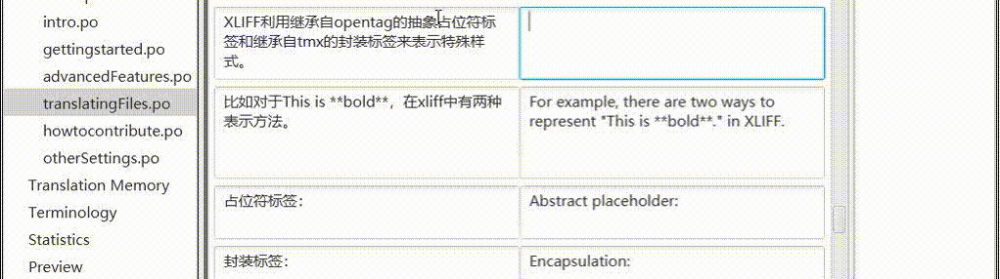
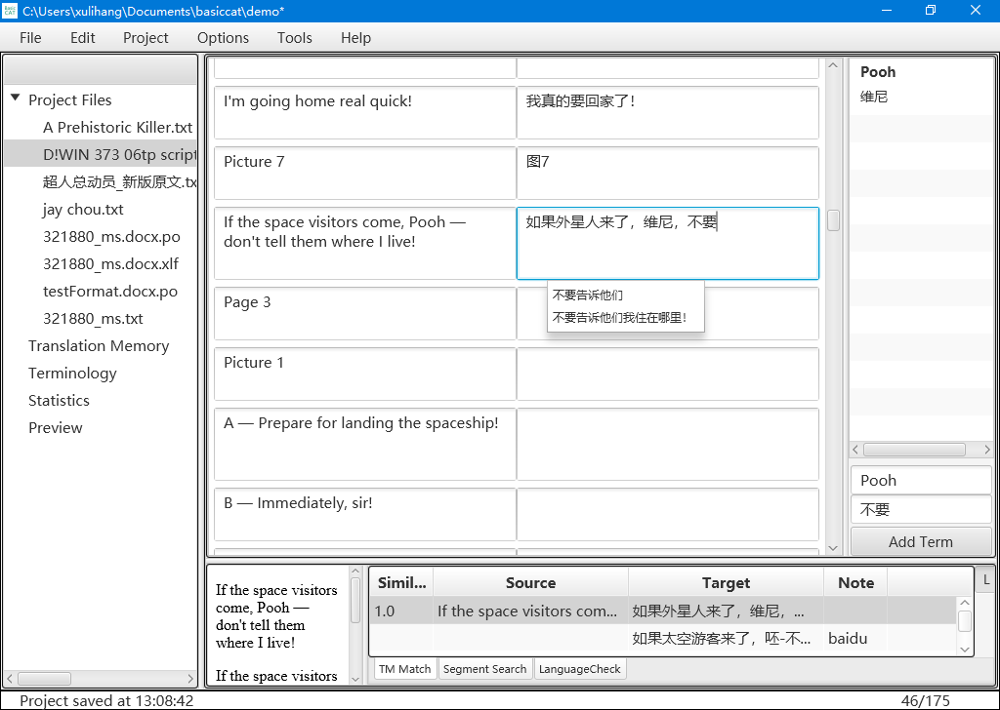

	<section class="site-header">
		<h1 class="smallcap"><a class="site-title" href="{{ '/' | prepend: site.baseurl | prepend: site.url }}">BasicCAT</a></h1>
		
		
	</section>

BasicCAT ist ein kostenloses Open-Source-Werkzeug für computergestützte Übersetzung, das Übersetzern ein einfaches und praktisches Arbeitsmittel an die Hand geben soll. Der Name BasicCAT hat zwei Gründe: Erstens ist das Programm einfach und benutzerfreundlich, zweitens ist es in der Programmiersprache Basic geschrieben, sodass jeder, der sich etwas Zeit zum Lernen nimmt, es beherrschen und auf Grundlage des Quellcodes von BasicCAT eine Software erstellen kann, die zu seinen eigenen Anforderungen passt.

Das Designprinzip von BasicCAT besteht darin, das Wandern des Blicks des Übersetzers so weit wie möglich zu reduzieren und die Aufmerksamkeit auf die Bearbeitung der Übersetzung zu lenken. Maschinelle Übersetzung, Terminologieabfragen per Textauswahl und Rechtschreibfehler werden als Dropdown-Listen unter dem Eingabefeld angezeigt.

{: width="1022" height="286"}

BasicCAT bietet die folgenden Funktionen, die Übersetzern helfen, ihre Aufgaben gelassen zu erledigen:

* Translation Memory
* Terminologieverwaltung
* Sprachprüfung
* Terminologieabfrage per Textauswahl
* Schnelles Einfügen
* Automatische Korrektur
* Interaktive maschinelle Übersetzung
* Export nach Word zur externen Prüfung
* Export einer Datei mit parallelen zweisprachigen Absätzen
* Segmentierung und Zusammenführung von Segmenten
* Abfrage mehrerer Online-Wörterbücher
* Aufruf der API gängiger Dienste für maschinelle Übersetzung
* Vorübersetzung des gesamten Textes mit Translation Memory und maschineller Übersetzung
* Unterstützung gängiger Quelldateiformate: txt, idml, xliff, gettext po
* Unterstützung der Standards Translation Memory TMX, Terminologieverwaltung TBX und Satzsegmentierung SRX
* Versionskontrolle mit Git

Links:

* [Herunterladen](https://www.basiccat.org/de/download)
* [Versionshinweise](https://www.basiccat.org/de/releasenote)
* [Dokumentation](https://docs.basiccat.org/en/latest/)

Wenn Sie Comics oder Bilder übersetzen möchten, verwenden Sie [ImageTrans](/de/imagetrans/).

Wenn Sie Videos oder Audiodateien übersetzen möchten, verwenden Sie [Silhouette](/de/silhouette/).

Weitere Produkte finden Sie in der [Produktliste](/de/products/).

{: width="1024" height="728"}
