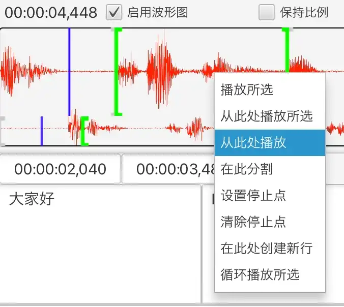
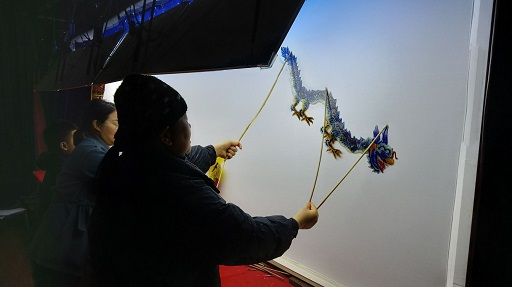

Silhouette ist ein Werkzeug für computergestützte Video- und Audioübersetzung.

{: width="1500" height="1160"}

## Funktionen

1. KI-gestützte Spracherkennung und Sprachaktivitätserkennung. Verwendet KI-Modelle wie OpenAI Whisper und Qwen3-ASR. Unterstützt verschiedene Sprachen wie Englisch, Chinesisch, Japanisch und Kantonesisch. Unterstützt auch verschiedene chinesische Dialekte wie Shanghainesisch und Hokkien.
2. KI-gestützte maschinelle Übersetzung, die den Kontext umfassend berücksichtigt. Unterstützt ChatGPT und DeepSeek.
3. Benutzerfreundliche Oberfläche mit Wellenformanzeige und verschiedenen Wiedergabesteuerungsfunktionen, mit denen sich Untertitel bequem anpassen lassen.

   {: width="676" height="604"}
4. Plattformübergreifend. Unterstützt Windows, macOS und Linux.
5. Import und Export von Untertiteldateien (SRT, TXT oder XLIFF).
6. Unterstützt die Ausrichtung der erkannten Zeitachse an einem vorhandenen Text ([Text-Audio-Synchronisierung](/de/align-text-with-audio/)).

## Download

* [Windows (x86_64)](https://github.com/xulihang/Silhouette/releases/download/v1.6.2/Silhouette-windows-x64.zip)
* [macOS (Apple CPU)](https://github.com/xulihang/Silhouette/releases/download/v1.6.2/Silhouette-mac-arm.dmg)
* [macOS (Intel CPU)](https://github.com/xulihang/Silhouette/releases/download/v1.6.2/Silhouette-mac-x64.dmg)
* [Linux](/de/silhouette/docs/#installation)

[Download über Cloud-Speicher](https://pan.quark.cn/s/0eefc3296abc)

## Kauf

Kaufen Sie Silhouette auf einer Drittplattform, um alle Funktionen freizuschalten:

* [MbD](https://mbd.pub/o/bread/Z56WlpZv)
* [FastSpring (Nutzer aus dem Ausland)](https://basiccat.onfastspring.com/silhouette)

Hinweis: Standardmäßig gibt es eine 7-tägige Testversion. Nach Ablauf der Testversion werden die Funktionen eingeschränkt: Es gibt Einschränkungen bei der Medienlänge, der Wellenform und dem Import.

## Mehr

* [Dokumentation](/de/silhouette/docs/)
* [Versionshinweise](/de/silhouette/release-notes/)
* [Technischer Support](/de/support/)
* [Videos](/de/silhouette/video/)

## Der Ursprung des Namens

Das Schattentheater aus meiner Heimatstadt Haining heißt auf Englisch leather-silhouette show und kann als eine frühe Form des Kinos angesehen werden. Daher habe ich das Wort silhouette gewählt, um die Software zu benennen.

{: width="512" height="287"}


