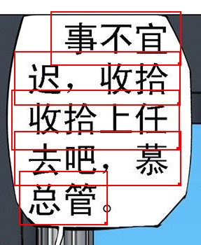
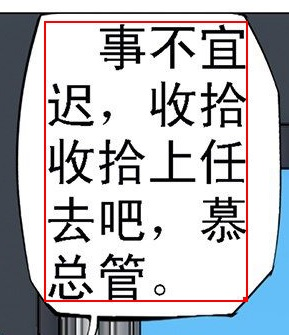

Recopilación de preguntas frecuentes sobre ImageTrans. Para buscar más preguntas, consulte [este enlace](https://github.com/xulihang/ImageTrans-docs/issues).

1. ¿Qué idiomas admite el software?

    El software en sí admite todos los idiomas. Las limitaciones principales están en el OCR y en la traducción automática.

    A continuación se muestran las páginas que describen los idiomas admitidos por algunos de los servicios de OCR y de traducción automática que utiliza ImageTrans:

    * <https://tesseract-ocr.github.io/tessdoc/Data-Files-in-different-versions.html>
    * <https://cloud.google.com/vision/docs/languages>
    * <https://cloud.google.com/translate/docs/languages>

2. ¿Se admite el japonés en vertical?

    Youdao, Baidu, Google, mangaOCR, tesseract y el OCR nativo de Windows 10 pueden reconocer japonés en vertical. ImageTrans también ofrece la función de convertir imágenes con texto en vertical a texto en horizontal, para que los motores de OCR que solo reconocen japonés en horizontal también puedan reconocer japonés en vertical.

3. ¿Cuál es la diferencia entre la versión de uso personal y la versión de uso comercial?

    Por ahora no hay diferencias de funcionalidad entre ambas. La versión de uso comercial está dirigida principalmente a empresas que la utilizan en trabajos de traducción comercial y, tras la compra, puede usarse en 5 dispositivos.

4. ¿Este precio es una cuota mensual o un pago único?

    La versión adquirida puede usarse de por vida e incluye actualizaciones gratuitas durante seis meses.

5. ¿En qué plataformas funciona el software? ¿Admite Linux?

    ImageTrans es una aplicación multiplataforma desarrollada con JavaFX y puede ejecutarse en Windows, macOS y Linux. El software depende de OpenCV y, por ello, se ofrecen bibliotecas específicas para Windows, macOS y Linux.

6. ¿Por qué el resultado de la traducción automática es igual al texto original?

    Primero debe especificar el par de idiomas de la traducción en la configuración del proyecto.

7. ¿Qué son las API de OCR y de traducción automática? ¿Cómo se solicitan?

    API es la abreviatura de interfaz de programación de aplicaciones. Empresas como Google y Microsoft ofrecen sus servicios de OCR y de traducción automática en forma de API para que software de terceros pueda utilizarlos. ImageTrans integra las API de OCR y de traducción automática más comunes. Por lo general, se necesita solicitar una clave de API para utilizarlas. Los pasos detallados están en la documentación de cada plataforma.

    A continuación se muestra un tutorial que encontré en internet sobre cómo solicitar la clave de API del OCR de Google Vision:

    <https://easyscreenocr.com/how-to-load-google-api-in-easyscreenocr-for-mac-lifetime-version/>

8. ¿Qué servicios de OCR y de traducción automática admite el software?

    A continuación se muestra la lista de los servicios en línea admitidos actualmente

    OCR: Baidu, Youdao, Tencent, Google, Microsoft Azure, OCRSPACE, ABBYY Cloud, Clova

    Traducción automática: Baidu, Youdao, Tencent, Niutrans, Google, Microsoft, Colorful Clouds, Cloudtranslation, Papago

    De forma predeterminada, ImageTrans incluye las claves de servicios de OCR como Baidu, Azure y OCRSPACE, así como las claves de servicios de traducción automática como Baidu, Tencent y Niutrans.

    También se admite OCR y traducción automática sin conexión. Véase la siguiente pregunta.

9. ¿Se puede usar el software sin conexión?

    El software se puede usar sin conexión. Sin embargo, la primera vez que se ejecuta es necesario estar conectado a internet para verificar si se realizó la compra; el registro se conserva durante 7 días.
    
    El software puede traducir imágenes sin conexión y admite OCR y traducción automática sin conexión.

    OCR sin conexión: tesseract, mangaOCR, OCR nativo de Windows 10, PaddleOCR, EasyOCR

    Traducción automática sin conexión: OPUS-CAT, eztrans, Sugoi
    
    El OCR y la traducción automática en línea, especialmente la traducción automática, suelen dar mejores resultados y cubrir más idiomas, pero también presentan problemas, como la necesidad de conexión a internet y límites en el número de solicitudes.

10. ¿Por qué algunos cuadros quedan sin resultado al ejecutar OCR y traducción automática por lotes?

    Los servicios de OCR y de traducción automática en línea tienen límites de solicitudes, por ejemplo, solo 5 por segundo. ImageTrans permite definir el intervalo de tiempo entre las solicitudes de OCR y de traducción automática para evitar este problema.

    Si es el OCR el que no devolvió resultado, puede que el motor de OCR no haya reconocido el texto.

11. ¿Por qué no se borró por completo el texto?

    El cuadro de texto debe cubrir completamente el texto y mantener cierta distancia respecto a los bordes del texto. Si el fondo del texto es complejo, muchas veces aún es necesario hacer el ajuste manualmente.

12. ¿El software tiene interfaz en inglés?

    Por ahora, el software ofrece la interfaz en dos idiomas: inglés y chino.
	
13. ¿Por qué no se fusionaron las líneas de texto?

	Hay varios motivos.

	1. La altura o la anchura de crecimiento predeterminada es demasiado pequeña; es necesario aumentar un poco el valor (generalmente la altura de la línea de texto).
	2. Existe un espacio entre las áreas de texto, lo que afecta la fusión. Hay varias formas de resolverlo:

		* Reducir el valor de expansión en píxeles
		* Fusionar manualmente
		* Desmarcar la opción de deducir si hay espacio
		
    Imagen de ejemplo:
	
	{: width="287" height="350"}
	
	Después de la fusión:
	
    {: width="289" height="335"}

