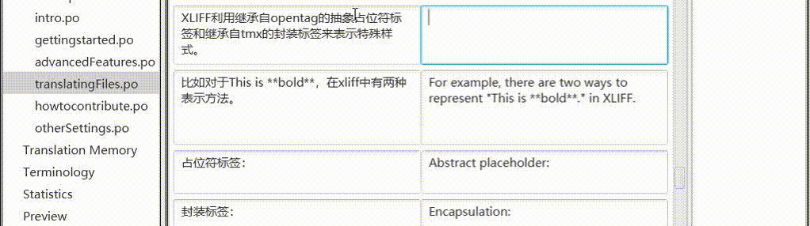
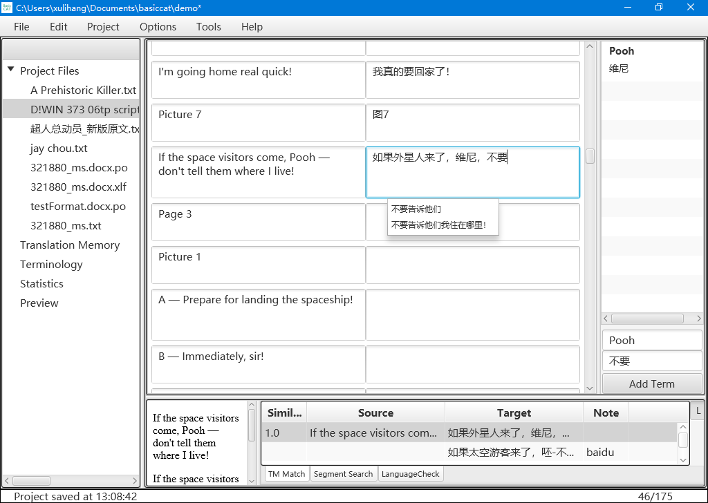

	<section class="site-header">
		<h1 class="smallcap"><a class="site-title" href="{{ '/' | prepend: site.baseurl | prepend: site.url }}">BasicCAT</a></h1>
		
		
	</section>

BasicCAT es una herramienta de traducción asistida por ordenador gratuita y de código abierto, creada para ofrecer a los traductores una herramienta de traducción sencilla y práctica. El nombre BasicCAT tiene dos razones: en primer lugar, porque es simple y fácil de usar; en segundo lugar, porque está escrito en el lenguaje Basic, de modo que cualquier persona, tras estudiarlo un tiempo, también puede dominarlo y crear, a partir del código fuente de BasicCAT, un software adaptado a sus propias necesidades.

El principio de diseño de BasicCAT es reducir al máximo el movimiento ocular del traductor y centrar su atención en la edición de la traducción. La traducción automática, la consulta de términos al seleccionar texto y las faltas de ortografía se muestran como listas desplegables debajo del cuadro de entrada.

{: width="1022" height="286"}

BasicCAT cuenta con las siguientes funciones, que ayudan al traductor a completar sus tareas de traducción con tranquilidad:

* Memoria de traducción
* Gestión de terminología
* Revisión lingüística
* Consulta de términos al seleccionar texto
* Relleno rápido
* Corrección automática
* Traducción automática interactiva
* Exportación a Word para revisión externa
* Exportación de un archivo con los párrafos bilingües en paralelo
* División y fusión de segmentos
* Consulta de varios diccionarios en línea
* Llamadas a la API de los principales servicios de traducción automática
* Pretraducción de todo el texto mediante memoria de traducción y traducción automática
* Compatibilidad con los formatos de archivo de origen habituales: txt, idml, xliff, gettext po
* Compatibilidad con los estándares de memoria de traducción TMX, de gestión de terminología TBX y de segmentación de frases SRX
* Control de versiones con Git

Enlaces:

* [Descargar](https://www.basiccat.org/es/download)
* [Notas de versión](https://www.basiccat.org/es/releasenote)
* [Documentación](https://docs.basiccat.org/en/latest/)

Si necesitas traducir cómics o imágenes, usa [ImageTrans](/es/imagetrans/).

Si necesitas traducir vídeo y audio, usa [Silhouette](/es/silhouette/).

Consulta más productos en la [lista de productos](/es/products/).

{: width="1024" height="728"}
