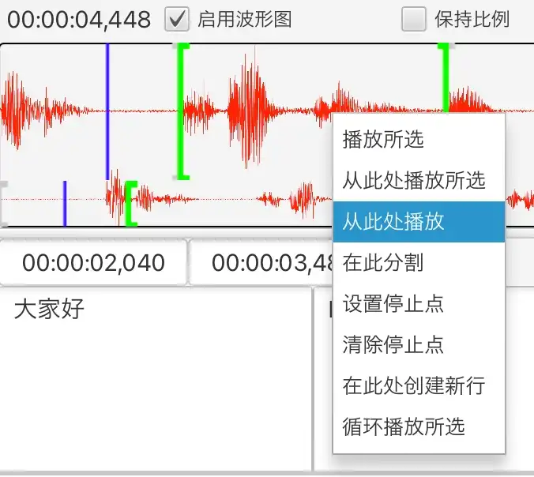
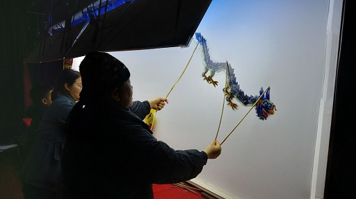

Silhouette es un software de traducción asistida por computador de vídeo y audio.

{: width="1500" height="1160"}

## Funciones

1. Reconocimiento de voz y detección de actividad de voz impulsados por IA. Utiliza modelos de inteligencia artificial como OpenAI Whisper y Qwen3-ASR. Admite diversos idiomas, como inglés, chino, japonés y cantonés. También admite dialectos chinos como el shanghainés y el hokkien.
2. Traducción automática impulsada por IA que tiene plenamente en cuenta el contexto. Admite el uso de ChatGPT y DeepSeek.
3. Interfaz fácil de usar, con visualización de la forma de onda y diversas funciones de control de reproducción que permiten ajustar los subtítulos con facilidad.

   {: width="676" height="604"}
4. Multiplataforma. Compatible con Windows, macOS y Linux.
5. Importación y exportación de archivos de subtítulos (SRT, TXT o XLIFF).
6. Permite alinear la línea de tiempo reconocida con un texto ya existente ([alineación de texto y audio](/es/align-text-with-audio/)).

## Descarga

* [Windows (x86_64)](https://github.com/xulihang/Silhouette/releases/download/v1.6.2/Silhouette-windows-x64.zip)
* [macOS (Apple CPU)](https://github.com/xulihang/Silhouette/releases/download/v1.6.2/Silhouette-mac-arm.dmg)
* [macOS (Intel CPU)](https://github.com/xulihang/Silhouette/releases/download/v1.6.2/Silhouette-mac-x64.dmg)
* [Linux](/es/silhouette/docs/#instalación)

[Descarga desde la nube](https://pan.quark.cn/s/0eefc3296abc)

## Compra

Compra Silhouette en una plataforma de terceros para desbloquear todas sus funciones:

* [MbD](https://mbd.pub/o/bread/Z56WlpZv)
* [FastSpring (usuarios del extranjero)](https://basiccat.onfastspring.com/silhouette)

Nota: de forma predeterminada, hay una prueba de 7 días. Una vez finalizada la prueba, las funciones se verán limitadas: habrá restricciones en la duración de los medios, la forma de onda y la importación.

## Más

* [Documentación](/es/silhouette/docs/)
* [Notas de versión](/es/silhouette/release-notes/)
* [Soporte técnico](/es/support/)
* [Vídeos](/es/silhouette/video/)

## El origen del nombre

El teatro de sombras de Haining, mi ciudad natal, se llama en inglés leather-silhouette show y puede considerarse una forma temprana de cine. De ahí tomé la palabra silhouette para nombrar el software.

{: width="512" height="287"}



