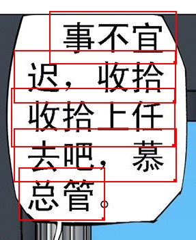
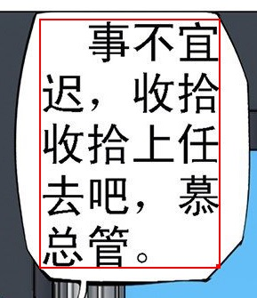

Здесь собраны ответы на часто задаваемые вопросы об ImageTrans. Другие вопросы можно поискать [здесь](https://github.com/xulihang/ImageTrans-docs/issues).

1. Какие языки поддерживает программа?

    Сама программа поддерживает все языки. Ограничения связаны главным образом с OCR и машинным переводом.

    Ниже приведены страницы с описанием языков, поддерживаемых некоторыми сервисами OCR и машинного перевода, которые использует ImageTrans:

    * <https://tesseract-ocr.github.io/tessdoc/Data-Files-in-different-versions.html>
    * <https://cloud.google.com/vision/docs/languages>
    * <https://cloud.google.com/translate/docs/languages>

2. Поддерживается ли вертикальный японский текст?

    Youdao, Baidu, Google, mangaOCR, tesseract и встроенный OCR Windows 10 умеют распознавать вертикальный японский текст. ImageTrans также предлагает функцию преобразования вертикального изображения в горизонтальное, благодаря чему движки OCR, поддерживающие распознавание только горизонтального японского текста, тоже смогут распознавать вертикальный.

3. В чём разница между версией для личного и версией для коммерческого использования?

    Сейчас функциональных различий между ними нет. Версия для коммерческого использования предназначена главным образом для компаний, занимающихся коммерческим переводом; после покупки её можно использовать на 5 устройствах.

4. Эта цена — ежемесячная плата или разовая покупка?

    Приобретённую версию можно использовать пожизненно, а также она включает бесплатные обновления в течение полугода.

5. На каких платформах работает программа? Поддерживается ли Linux?

    ImageTrans — кроссплатформенное приложение, разработанное на JavaFX; оно работает под Windows, macOS и Linux. Программа зависит от OpenCV, поэтому для Windows, macOS и Linux специально предоставляются соответствующие библиотеки.

6. Почему результат машинного перевода совпадает с исходным текстом?

    Сначала нужно указать языковую пару перевода в настройках проекта.

7. Что такое API для OCR и машинного перевода? Как их получить?

    API — это сокращение от «интерфейс программирования приложений». Такие компании, как Google и Microsoft, открывают свои технологии OCR и машинного перевода в виде API, чтобы сторонние программы могли к ним обращаться. ImageTrans интегрирует распространённые API для OCR и машинного перевода. Как правило, для обращения к этим API требуется получить ключ API. Подробные инструкции см. в документации соответствующих платформ.

    Ниже приведён найденный мной в интернете урок о том, как получить ключ API для OCR Google Vision:

    <https://easyscreenocr.com/how-to-load-google-api-in-easyscreenocr-for-mac-lifetime-version/>

8. Какие сервисы OCR и машинного перевода поддерживает программа?

    Ниже приведён список поддерживаемых в настоящее время онлайн-сервисов

    OCR: Baidu, Youdao, Tencent, Google, Microsoft Azure, OCRSPACE, ABBYY Cloud, Clova

    Машинный перевод: Baidu, Youdao, Tencent, Niutrans, Google, Microsoft, Colorful Clouds, Cloudtranslation, Papago

    По умолчанию ImageTrans включает ключи для сервисов OCR, таких как Baidu, Azure и OCRSPACE, а также ключи для сервисов машинного перевода, таких как Baidu, Tencent и Niutrans.

    Кроме того, поддерживаются офлайн-OCR и машинный перевод — см. следующий вопрос.

9. Можно ли использовать программу без подключения к интернету?

    Программу можно использовать офлайн. Однако при первом запуске требуется подключение к интернету для проверки факта покупки; запись сохраняется на 7 дней.
    
    Программа может переводить изображения офлайн и поддерживает офлайн-версии OCR и машинного перевода.

    Офлайн-OCR: tesseract, mangaOCR, встроенный OCR Windows 10, PaddleOCR, EasyOCR

    Офлайн-машинный перевод: OPUS-CAT, eztrans, Sugoi
    
    Онлайн-OCR и машинный перевод, особенно машинный перевод, обычно дают лучшие результаты и поддерживают больше языков, но при этом требуют подключения к интернету и имеют ограничения на количество запросов.

10. Почему при пакетном выполнении OCR и машинного перевода некоторые рамки остаются без результата?

    Онлайн-сервисы OCR и машинного перевода имеют ограничения на запросы, например не более 5 запросов в секунду. ImageTrans позволяет задать интервал между запросами OCR и машинного перевода, чтобы избежать этой проблемы.

    Если результат отсутствует при OCR, возможно, движок OCR не распознал текст.

11. Почему текст удалён не полностью?

    Текстовый блок должен полностью покрывать текст и иметь некоторый отступ от его краёв. Если фон под текстом сложный, часто требуется ручная обработка.

12. Есть ли у программы английский интерфейс?

    В настоящее время программа поддерживает два языка интерфейса: английский и китайский.
	
13. Почему строки текста не объединились?

	Есть несколько причин.

	1. Значение приращения высоты или ширины по умолчанию слишком мало — его нужно немного увеличить (обычно это высота строки текста).
	2. Между текстовыми областями есть промежуток, что мешает объединению. Есть несколько способов решения:

		* Уменьшить значение расширения в пикселях
		* Объединить вручную
		* Отключить проверку наличия промежутка
		
    Пример изображения:
	
	{: width="287" height="350"}
	
	После объединения:
	
    {: width="289" height="335"}


