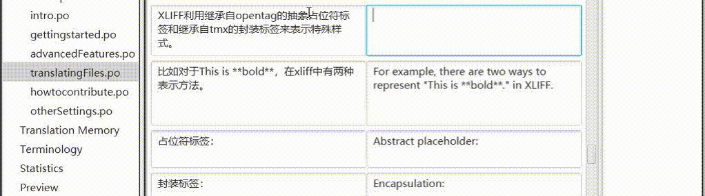
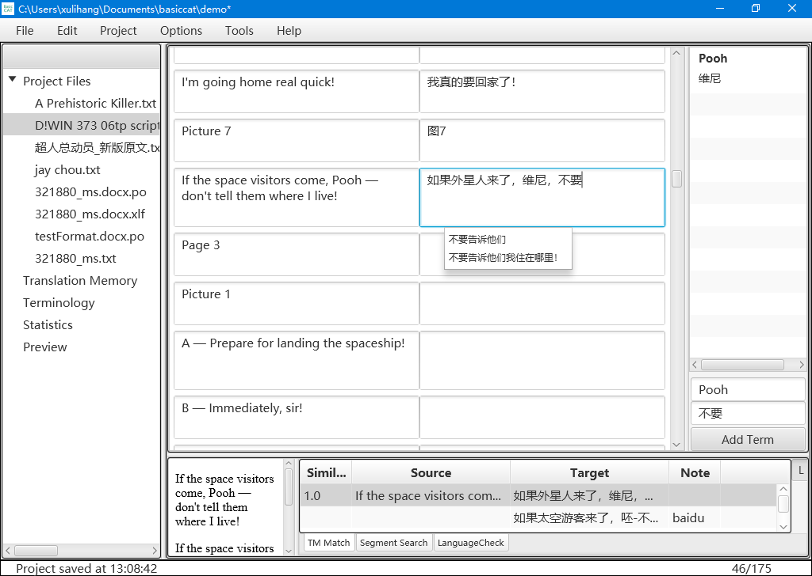

	<section class="site-header">
		<h1 class="smallcap"><a class="site-title" href="{{ '/' | prepend: site.baseurl | prepend: site.url }}">BasicCAT</a></h1>
		
		
	</section>

BasicCAT — это бесплатный открытый инструмент автоматизированного перевода, созданный, чтобы дать переводчикам простое и практичное средство работы. Название BasicCAT объясняется двумя причинами: во-первых, программа проста и удобна в использовании; во-вторых, она написана на языке Basic, так что любой человек, потратив некоторое время на его изучение, сможет освоить её и на основе исходного кода BasicCAT создать программу, подходящую под свои нужды.

Принцип дизайна BasicCAT — сводить к минимуму перемещение взгляда переводчика и сосредоточивать его на редактировании перевода. Машинный перевод, поиск терминов по выделенному тексту и орфографические ошибки отображаются в виде выпадающих списков под полем ввода.

{: width="1022" height="286"}

BasicCAT обладает следующими возможностями, которые помогают переводчику спокойно справляться с переводческими задачами:

* Память переводов
* Управление терминологией
* Проверка языка
* Поиск терминов по выделенному тексту
* Быстрое заполнение
* Автоматическая правка
* Интерактивный машинный перевод
* Экспорт в Word для внешней проверки
* Экспорт файла с параллельными двуязычными абзацами
* Разбиение и объединение сегментов
* Обращение к нескольким онлайн-словарям
* Вызов API популярных сервисов машинного перевода
* Предварительный перевод всего текста с помощью памяти переводов и машинного перевода
* Поддержка распространённых форматов исходных файлов: txt, idml, xliff, gettext po
* Поддержка стандартов памяти переводов TMX, управления терминологией TBX и сегментации предложений SRX
* Управление версиями с помощью Git

Ссылки:

* [Скачать](https://www.basiccat.org/ru/download)
* [Примечания к выпускам](https://www.basiccat.org/ru/releasenote)
* [Документация](https://docs.basiccat.org/en/latest/)

Для перевода комиксов и изображений используйте [ImageTrans](/ru/imagetrans/).

Для перевода видео и аудио используйте [Silhouette](/ru/silhouette/).

Другие продукты — в [списке продуктов](/ru/products/).

{: width="1024" height="728"}
