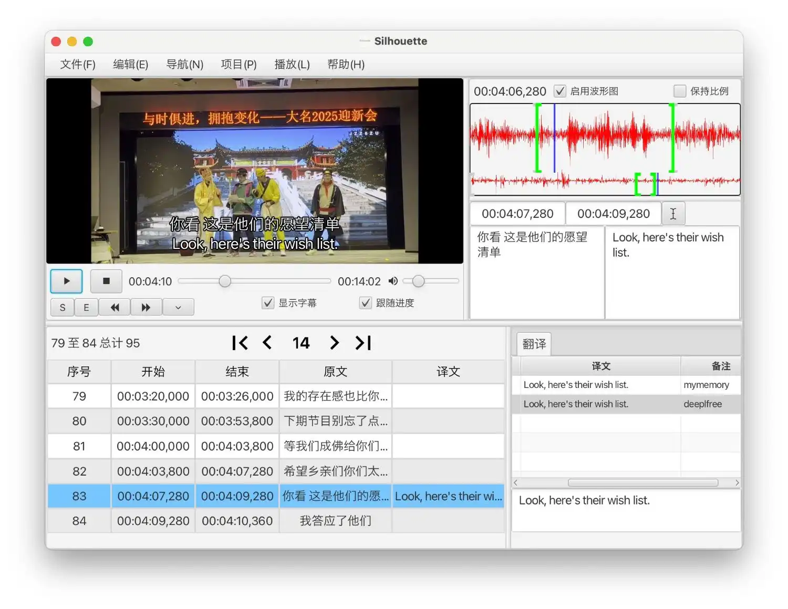

## Поддерживаемые операционные системы

* Windows 7+
* macOS 10.15+
* Linux

## Установка

Для Windows распакуйте архив и запустите программу с помощью `Silhouette.exe`.

Для macOS перетащите приложение из файла dmg в папку `Applications`, чтобы установить его. Если появляется сообщение о том, что пакет повреждён, откройте терминал и выполните следующую команду:

```bash
sudo xattr -rd com.apple.quarantine /Applications/Silhouette.app
```

Для Linux можно использовать файлы из zip-архива для Windows. Для запуска программы необходимо установить FFmpeg, Whisper.cpp, Java и JavaFX. Можно использовать [файл-шаблон](https://github.com/xulihang/Silhouette/releases/download/v1.1.0/Silhouette-Linux-template.zip), содержащий эти зависимости. Затем также нужно скачать ONNXRuntime и распаковать файлы so в каталог программы: [linux-onnxruntime-1.20.0.zip](https://github.com/xulihang/onnxruntime-for-win7/releases/download/builds/linux-onnxruntime-1.20.0.zip).

## Настройки

При открытии программы необходимо ввести номер заказа и адрес электронной почты для подтверждения покупки. Можно сначала опробовать программу с помощью 7-дневного пробного периода или ограниченного режима.

Кроме того, необходимо выполнить другие настройки.


1. Модель Whisper. Для распознавания речи необходимо выбрать модель Whisper. Ссылку для скачивания можно найти в программе или [здесь](https://github.com/xulihang/Silhouette_plugins/#whisper-models).
2. Ключи API. Если нужно использовать сервисы перевода, такие как ChatGPT, Google или DeepL, необходимо указать ключи API в параметрах.


## Быстрый старт

Скриншот Silhouette:

{: width="1500" height="1160"}

В левом верхнем углу находится видеоплеер с различными элементами управления.

В левом нижнем углу находится таблица с существующими строками субтитров.

В правом верхнем углу можно просмотреть осциллограмму, соответствующую текущей строке субтитров, и отредактировать её временную метку и текст.

В правом нижнем углу можно просмотреть результаты нескольких сервисов перевода.

Ниже описан основной процесс перевода видео- или аудиофайла с помощью Silhouette:

1. Откройте медиафайл с помощью меню «Файл» в строке меню и настройте языковую пару.
2. С помощью меню «Правка» распознайте речь, обнаружьте речевую активность и отредактируйте строки субтитров.
3. После транскрибирования и перевода можно экспортировать результат в файл SRT или txt с разделением табуляцией. Также можно импортировать данные из этих файлов.


