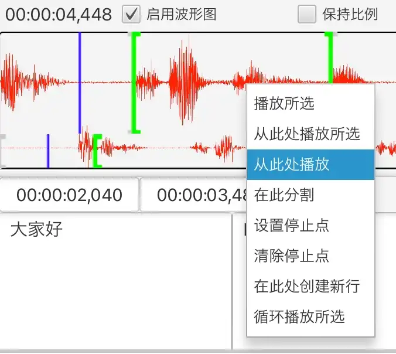
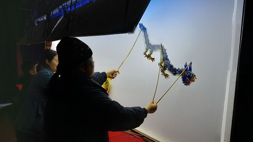

Silhouette — это инструмент автоматизированного перевода видео и аудио.

{: width="1500" height="1160"}

## Функции

1. Распознавание речи и обнаружение речевой активности на основе ИИ. Используются модели искусственного интеллекта, такие как OpenAI Whisper и Qwen3-ASR. Поддерживаются различные языки, включая английский, китайский, японский и кантонский, а также китайские диалекты, такие как шанхайский и южноминьский.
2. Машинный перевод на основе ИИ, полноценно учитывающий контекст. Поддерживается использование ChatGPT и DeepSeek.
3. Удобный интерфейс с отображением осциллограммы и различными функциями управления воспроизведением, позволяющими удобно редактировать субтитры.

   {: width="676" height="604"}
4. Кроссплатформенность. Поддерживаются Windows, macOS и Linux.
5. Импорт и экспорт файлов субтитров (SRT, TXT или XLIFF).
6. Поддержка выравнивания распознанной временной шкалы с имеющимся текстом ([выравнивание текста и аудио](/ru/align-text-with-audio/)).

## Скачать

* [Windows (x86_64)](https://github.com/xulihang/Silhouette/releases/download/v1.6.2/Silhouette-windows-x64.zip)
* [macOS (Apple CPU)](https://github.com/xulihang/Silhouette/releases/download/v1.6.2/Silhouette-mac-arm.dmg)
* [macOS (Intel CPU)](https://github.com/xulihang/Silhouette/releases/download/v1.6.2/Silhouette-mac-x64.dmg)
* [Linux](/ru/silhouette/docs/#установка)

[Скачать с облачного диска](https://pan.quark.cn/s/0eefc3296abc)

## Покупка

Приобретите Silhouette на сторонней платформе, чтобы разблокировать все функции:

* [MbD](https://mbd.pub/o/bread/Z56WlpZv)
* [FastSpring (зарубежные пользователи)](https://basiccat.onfastspring.com/silhouette)

Примечание: по умолчанию доступен 7-дневный пробный период. После его окончания функции будут ограничены: будут действовать ограничения на длительность медиафайлов, осциллограмму и импорт.

## Дополнительно

* [Документация](/ru/silhouette/docs/)
* [Примечания к выпускам](/ru/silhouette/release-notes/)
* [Техническая поддержка](/ru/support/)
* [Видео](/ru/silhouette/video/)

## Происхождение названия

Театр теней в моём родном Хайнине по-английски называется leather-silhouette show и может считаться одной из ранних форм кинематографа. Отсюда я и взял слово silhouette для названия программы.

{: width="512" height="287"}


