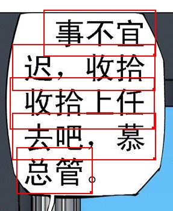
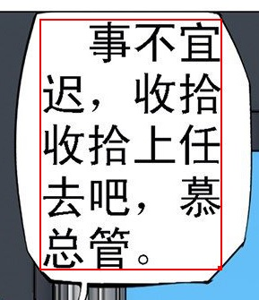

รวบรวมคำถามที่พบบ่อยเกี่ยวกับ ImageTrans สำหรับคำถามอื่น ๆ สามารถค้นหาได้ที่[ที่นี่](https://github.com/xulihang/ImageTrans-docs/issues)

1. ซอฟต์แวร์รองรับภาษาใดบ้าง

    ตัวซอฟต์แวร์เองรองรับทุกภาษา ข้อจำกัดหลักอยู่ที่ OCR และการแปลด้วยเครื่อง

    ด้านล่างคือหน้าคำอธิบายภาษาที่รองรับของบริการ OCR และการแปลด้วยเครื่องบางส่วนที่ ImageTrans ใช้งาน:

    * <https://tesseract-ocr.github.io/tessdoc/Data-Files-in-different-versions.html>
    * <https://cloud.google.com/vision/docs/languages>
    * <https://cloud.google.com/translate/docs/languages>

2. รองรับภาษาญี่ปุ่นแบบแนวตั้งหรือไม่

    Youdao, Baidu, Google, mangaOCR, tesseract และ OCR ที่มีมาใน Windows 10 ต่างสามารถรู้จำภาษาญี่ปุ่นแบบแนวตั้งได้ ImageTrans ยังมีฟังก์ชันแปลงภาพแนวตั้งเป็นแนวนอน เพื่อให้เอนจิน OCR ที่รองรับการรู้จำภาษาญี่ปุ่นแนวนอนเท่านั้นสามารถรู้จำภาษาญี่ปุ่นแนวตั้งได้เช่นกัน

3. เวอร์ชันสำหรับใช้ส่วนตัวและเวอร์ชันสำหรับใช้เชิงพาณิชย์แตกต่างกันอย่างไร

    ปัจจุบันทั้งสองเวอร์ชันไม่มีความแตกต่างด้านฟังก์ชัน เวอร์ชันเชิงพาณิชย์มุ่งเน้นสำหรับบริษัทที่ใช้งานงานแปลเชิงพาณิชย์ เมื่อซื้อแล้วสามารถใช้งานได้บนอุปกรณ์ 5 เครื่อง

4. ราคานี้เป็นค่าบริการรายเดือนหรือค่าซื้อขาดครั้งเดียว

    เวอร์ชันที่ซื้อสามารถใช้งานได้ตลอดชีพ และได้รับการอัปเดตฟรีภายในครึ่งปี

5. ซอฟต์แวร์รองรับการทำงานบนแพลตฟอร์มใดบ้าง รองรับ Linux หรือไม่

    ImageTrans เป็นแอปพลิเคชันข้ามแพลตฟอร์มที่พัฒนาด้วย JavaFX สามารถทำงานบน Windows, macOS และ Linux ซอฟต์แวร์พึ่งพา OpenCV จึงมีไลบรารีสำหรับการทำงานบน Windows, macOS และ Linux โดยเฉพาะ

6. ทำไมผลลัพธ์การแปลด้วยเครื่องจึงเหมือนกับต้นฉบับ

    ต้องระบุคู่ภาษาที่ต้องการแปลในการตั้งค่าโปรเจกต์ก่อน

7. OCR และ API การแปลด้วยเครื่องคืออะไร ต้องสมัครอย่างไร

    API ย่อมาจาก Application Programming Interface (อินเทอร์เฟซการเขียนโปรแกรมแอปพลิเคชัน) บริษัทอย่าง Google, Microsoft และอื่น ๆ เปิดให้บริการ OCR และการแปลด้วยเครื่องที่พัฒนาขึ้นในรูปแบบ API เพื่อให้ซอฟต์แวร์ของบุคคลที่สามเรียกใช้งาน ImageTrans ได้รวม API OCR และการแปลด้วยเครื่องที่พบได้บ่อยไว้แล้ว API เหล่านี้โดยปกติต้องสมัครรับคีย์ API เพื่อเรียกใช้งาน วิธีดำเนินการโดยละเอียดสามารถดูได้ในเอกสารของแต่ละแพลตฟอร์ม

    ด้านล่างคือบทแนะนำการสมัครคีย์ API OCR ของ Google Vision ที่ฉันค้นพบทางอินเทอร์เน็ต:

    <https://easyscreenocr.com/how-to-load-google-api-in-easyscreenocr-for-mac-lifetime-version/>

8. ซอฟต์แวร์รองรับบริการ OCR และการแปลด้วยเครื่องใดบ้าง

    ด้านล่างคือรายการบริการออนไลน์ที่รองรับในปัจจุบัน

    OCR: Baidu, Youdao, Tencent, Google, Microsoft Azure, OCRSPACE, ABBYY Cloud, Clova

    การแปลด้วยเครื่อง: Baidu, Youdao, Tencent, Niutrans, Google, Microsoft, Colorful Clouds, Cloudtranslation, Papago

    โดยค่าเริ่มต้น ImageTrans มีคีย์ของบริการ OCR เช่น Baidu, Azure, OCRSPACE และคีย์ของบริการแปลด้วยเครื่อง เช่น Baidu, Tencent, Niutrans

    นอกจากนี้ยังรองรับ OCR และการแปลด้วยเครื่องแบบออฟไลน์ ดูคำถามถัดไป

9. ซอฟต์แวร์สามารถใช้งานแบบออฟไลน์ได้หรือไม่

    ซอฟต์แวร์สามารถใช้งานแบบออฟไลน์ได้ แต่การใช้งานครั้งแรกต้องเชื่อมต่ออินเทอร์เน็ตเพื่อตรวจสอบว่าซื้อแล้วหรือไม่ โดยบันทึกไว้ 7 วัน
    
    ซอฟต์แวร์สามารถแปลภาพแบบออฟไลน์ได้ และรองรับ OCR กับการแปลด้วยเครื่องแบบออฟไลน์

    OCR แบบออฟไลน์: tesseract, mangaOCR, OCR ที่มีมาใน Windows 10, PaddleOCR, EasyOCR

    การแปลด้วยเครื่องแบบออฟไลน์: OPUS-CAT, eztrans, Sugoi
    
    OCR และการแปลด้วยเครื่องแบบออนไลน์ โดยเฉพาะการแปลด้วยเครื่อง มักให้ผลลัพธ์ที่ดีกว่าและรองรับภาษาที่ครอบคลุมกว่า แต่ก็มีปัญหาอย่างการต้องเชื่อมต่ออินเทอร์เน็ตและการจำกัดจำนวนคำขอ

10. ทำไมเมื่อทำ OCR และการแปลด้วยเครื่องแบบเป็นชุด บางกรอบจึงไม่มีผลลัพธ์

    บริการ OCR และการแปลด้วยเครื่องแบบออนไลน์มีการจำกัดจำนวนคำขอ เช่น สามารถส่งคำขอได้เพียง 5 ครั้งต่อวินาที ImageTrans อนุญาตให้ตั้งค่าช่วงเวลาระหว่างคำขอ OCR และการแปลด้วยเครื่องเพื่อหลีกเลี่ยงปัญหานี้

    หากเป็น OCR ที่ไม่มีผลลัพธ์ อาจเป็นเพราะเอนจิน OCR ไม่สามารถรู้จำข้อความได้

11. ทำไมข้อความจึงไม่ถูกลบออกทั้งหมด

    กรอบข้อความต้องครอบคลุมข้อความทั้งหมด และมีระยะห่างจากขอบข้อความพอสมควร หากพื้นหลังของข้อความซับซ้อน มักต้องจัดการด้วยตนเอง

12. ซอฟต์แวร์มีอินเทอร์เฟซภาษาอังกฤษหรือไม่

    ปัจจุบันซอฟต์แวร์รองรับภาษาอินเทอร์เฟซสองภาษา คือภาษาอังกฤษและภาษาจีน
		
13. ทำไมบรรทัดข้อความจึงไม่ถูกผสาน

	มีหลายสาเหตุ

	1. ค่าเพิ่มความสูงหรือความกว้างเริ่มต้นเล็กเกินไป ต้องปรับค่าให้ใหญ่ขึ้นเล็กน้อย (โดยทั่วไปคือความสูงของบรรทัดข้อความ)
	2. มีช่องว่างระหว่างพื้นที่ข้อความ ซึ่งส่งผลต่อการผสาน มีหลายวิธีในการจัดการ:

		* ลดค่าการขยายพิกเซล
		* ผสานด้วยตนเอง
		* ยกเลิกการตรวจสอบว่ามีช่องว่างหรือไม่
		
    ภาพตัวอย่าง:
	
	{: width="287" height="350"}
	
	หลังผสาน:
	
    {: width="289" height="335"}


