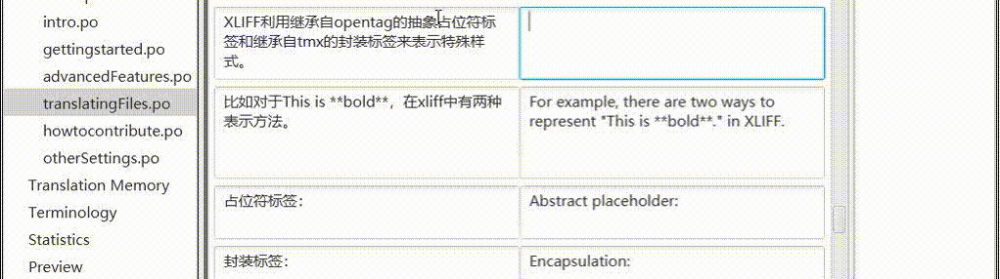
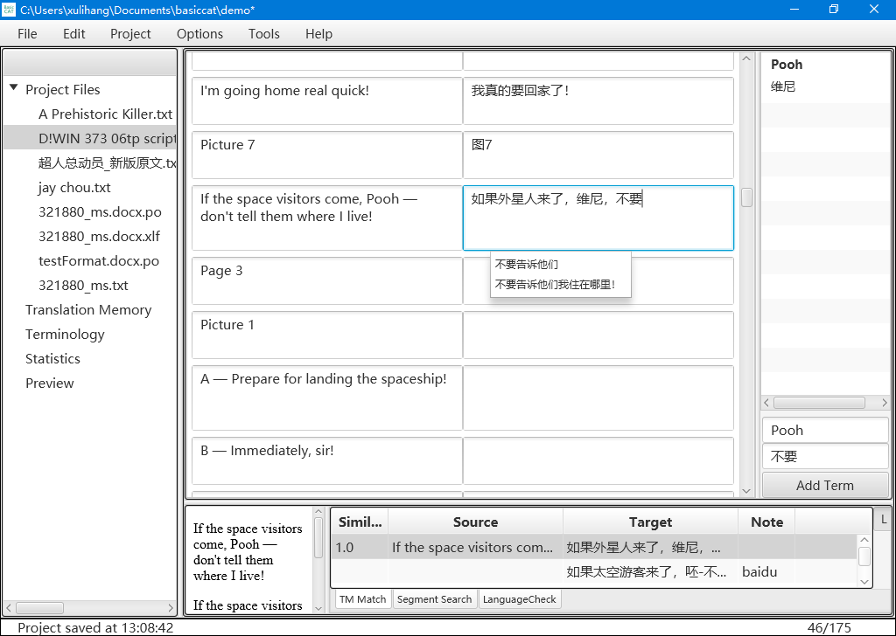

	<section class="site-header">
		<h1 class="smallcap"><a class="site-title" href="{{ '/' | prepend: site.baseurl | prepend: site.url }}">BasicCAT</a></h1>
		
		
	</section>

BasicCAT เป็นซอฟต์แวร์แปลภาษาช่วยด้วยคอมพิวเตอร์ที่ฟรีและโอเพนซอร์ส สร้างขึ้นเพื่อมอบเครื่องมือแปลที่เรียบง่ายและใช้งานได้จริงแก่นักแปล ชื่อ BasicCAT มีที่มาสองประการ ประการแรกเพราะใช้งานง่ายและเรียบง่าย ประการที่สองเพราะเขียนด้วยภาษา Basic ทุกคนจึงเรียนรู้จนเชี่ยวชาญได้ในเวลาอันสมควร และนำซอร์สโค้ดของ BasicCAT ไปดัดแปลงเป็นซอฟต์แวร์ที่เหมาะกับความต้องการของตนเองได้

หลักการออกแบบของ BasicCAT คือลดการกวาดสายตาของนักแปลให้มากที่สุดและมุ่งความสนใจไปที่การแก้ไขคำแปล การแปลด้วยเครื่อง การค้นหาคำศัพท์จากการเลือกข้อความ และการสะกดผิด จะแสดงเป็นรายการแบบเลื่อนลงใต้ช่องกรอกข้อความ

{: width="1022" height="286"}

BasicCAT มีฟังก์ชันต่อไปนี้ ช่วยให้นักแปลทำงานแปลได้อย่างสบายใจ:

* หน่วยความจำการแปล
* การจัดการคำศัพท์
* การตรวจทานภาษา
* การค้นหาคำศัพท์จากการเลือกข้อความ
* การเติมข้อความอัตโนมัติ
* การแก้ไขอัตโนมัติ
* การแปลด้วยเครื่องแบบโต้ตอบ
* ส่งออกเป็น Word เพื่อตรวจทานภายนอก
* ส่งออกไฟล์ย่อหน้าสองภาษาแบบเทียบกัน
* การแบ่งและรวมเซกเมนต์
* เรียกใช้พจนานุกรมออนไลน์หลายแบบ
* การเรียก API ของบริการแปลด้วยเครื่องที่ใช้กันทั่วไป
* รองรับการแปลล่วงหน้าทั้งฉบับด้วยหน่วยความจำการแปลและการแปลด้วยเครื่อง
* รองรับรูปแบบไฟล์ต้นฉบับที่ใช้กันทั่วไป: txt, idml, xliff, gettext po
* รองรับมาตรฐานหน่วยความจำการแปล TMX การจัดการคำศัพท์ TBX และการแบ่งประโยค SRX
* ควบคุมเวอร์ชันด้วย Git

ลิงก์:

* [ดาวน์โหลด](https://www.basiccat.org/th/download)
* [บันทึกการเผยแพร่](https://www.basiccat.org/th/releasenote)
* [เอกสาร](https://docs.basiccat.org/en/latest/)

หากต้องการแปลการ์ตูน/รูปภาพ โปรดใช้ [ImageTrans](/th/imagetrans/)

หากต้องการแปลวิดีโอและเสียง โปรดใช้ [Silhouette](/th/silhouette/)

ดูผลิตภัณฑ์เพิ่มเติมได้ที่ [รายการผลิตภัณฑ์](/th/products/)

{: width="1024" height="728"}
