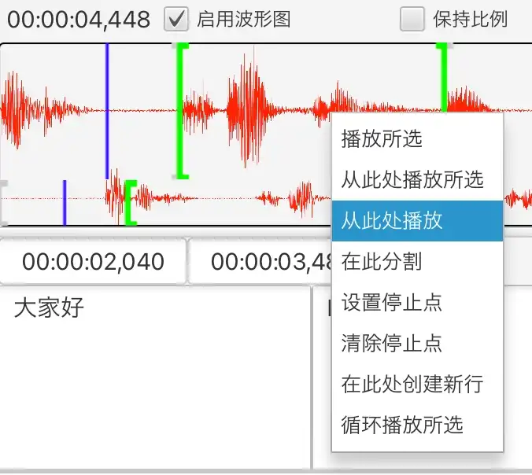
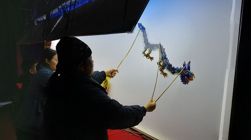

Silhouette เป็นซอฟต์แวร์แปลวิดีโอและเสียงช่วยด้วยคอมพิวเตอร์

{: width="1500" height="1160"}

## ฟังก์ชัน

1. การรู้จำเสียงพูดและการตรวจจับเสียงพูดที่ขับเคลื่อนด้วย AI ใช้โมเดลปัญญาประดิษฐ์อย่าง OpenAI Whisper และ Qwen3-ASR รองรับภาษาต่าง ๆ เช่น อังกฤษ จีน ญี่ปุ่น และกวางตุ้ง รวมถึงภาษาถิ่นจีนต่าง ๆ เช่น ภาษาถิ่นเซี่ยงไฮ้และภาษาถิ่นหมิ่นหนาน
2. การแปลด้วยเครื่องที่ขับเคลื่อนด้วย AI โดยคำนึงถึงบริบทอย่างเต็มที่ รองรับการเรียกใช้ ChatGPT และ DeepSeek
3. อินเทอร์เฟซที่ใช้งานง่าย รองรับการแสดงรูปคลื่นเสียง มีฟังก์ชันควบคุมการเล่นต่าง ๆ ช่วยให้ปรับซับไตเติลได้อย่างสะดวก

   {: width="676" height="604"}
4. รองรับหลายแพลตฟอร์ม รองรับ Windows, macOS และ Linux
5. การนำเข้าและส่งออกไฟล์ซับไตเติล (SRT, TXT หรือ XLIFF)
6. รองรับการจัดแนวไทม์ไลน์ที่รู้จำได้กับข้อความที่มีอยู่แล้ว ([การจัดแนวข้อความและเสียง](/th/align-text-with-audio/))

## ดาวน์โหลด

* [Windows (x86_64)](https://github.com/xulihang/Silhouette/releases/download/v1.6.2/Silhouette-windows-x64.zip)
* [macOS (Apple CPU)](https://github.com/xulihang/Silhouette/releases/download/v1.6.2/Silhouette-mac-arm.dmg)
* [macOS (Intel CPU)](https://github.com/xulihang/Silhouette/releases/download/v1.6.2/Silhouette-mac-x64.dmg)
* [Linux](/th/silhouette/docs/#ติดตั้ง)

[ดาวน์โหลดจากคลาวด์ดิสก์](https://pan.quark.cn/s/0eefc3296abc)

## การซื้อ

ไปยังแพลตฟอร์มของบุคคลที่สามเพื่อซื้อ Silhouette และปลดล็อกฟังก์ชันทั้งหมด:

* [MbD](https://mbd.pub/o/bread/Z56WlpZv)
* [FastSpring (ผู้ใช้ต่างประเทศ)](https://basiccat.onfastspring.com/silhouette)

หมายเหตุ: โดยค่าเริ่มต้นมีช่วงทดลองใช้ 7 วัน หลังจากช่วงทดลองใช้ ฟังก์ชันจะถูกจำกัด ได้แก่ ความยาวของสื่อ รูปคลื่นเสียง และการนำเข้า

## เพิ่มเติม

* [เอกสาร](/th/silhouette/docs/)
* [บันทึกการเผยแพร่](/th/silhouette/release-notes/)
* [การสนับสนุนทางเทคนิค](/th/support/)
* [วิดีโอ](/th/silhouette/video/)

## ที่มาของชื่อ

การแสดงหุ่นเงาของไห่หนิง บ้านเกิดของผม มีชื่อภาษาอังกฤษว่า leather-silhouette show ซึ่งถือได้ว่าเป็นภาพยนตร์รูปแบบหนึ่งในยุคแรก ๆ ผมจึงนำคำว่า silhouette มาใช้ตั้งชื่อซอฟต์แวร์

{: width="512" height="287"}


