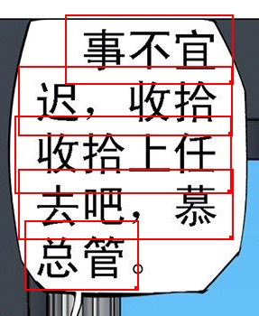
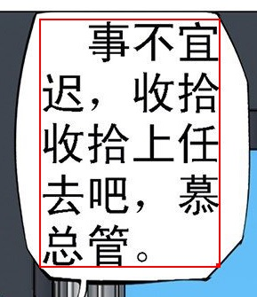

Tổng hợp các câu hỏi thường gặp về ImageTrans, bạn có thể tìm kiếm thêm câu hỏi tại [đây](https://github.com/xulihang/ImageTrans-docs/issues).

1. Phần mềm hỗ trợ những ngôn ngữ nào?

    Bản thân phần mềm hỗ trợ mọi ngôn ngữ. Hạn chế chủ yếu nằm ở OCR và dịch máy.

    Dưới đây là các trang mô tả ngôn ngữ được hỗ trợ bởi một số dịch vụ OCR và dịch máy mà ImageTrans sử dụng:

    * <https://tesseract-ocr.github.io/tessdoc/Data-Files-in-different-versions.html>
    * <https://cloud.google.com/vision/docs/languages>
    * <https://cloud.google.com/translate/docs/languages>

2. Có hỗ trợ tiếng Nhật dọc không?

    Youdao, Baidu, Google, mangaOCR, tesseract và OCR tích hợp của Windows 10 đều có thể nhận dạng tiếng Nhật dọc. ImageTrans còn cung cấp chức năng chuyển ảnh dọc thành ảnh ngang, để các công cụ OCR chỉ hỗ trợ nhận dạng tiếng Nhật ngang cũng có thể nhận dạng tiếng Nhật dọc.

3. Phiên bản dùng cho mục đích cá nhân và phiên bản dùng cho mục đích thương mại khác nhau như thế nào?

    Hiện tại hai phiên bản không có khác biệt về tính năng. Phiên bản dùng cho mục đích thương mại chủ yếu hướng tới các công ty sử dụng cho công việc dịch thuật thương mại, sau khi mua có thể sử dụng trên 5 thiết bị.

4. Giá này là phí hàng tháng hay phí mua đứt một lần?

    Phiên bản đã mua có thể sử dụng trọn đời và được cập nhật miễn phí trong vòng nửa năm.

5. Phần mềm chạy trên những nền tảng nào, có hỗ trợ Linux không?

    ImageTrans là ứng dụng đa nền tảng được phát triển dựa trên JavaFX, có thể chạy trên Windows, macOS và Linux. Phần mềm phụ thuộc vào OpenCV, vì vậy có cung cấp riêng thư viện chạy cho Windows, macOS và Linux.

6. Tại sao kết quả dịch máy lại giống với văn bản gốc?

    Cần chỉ định cặp ngôn ngữ dịch trong phần cài đặt dự án trước.

7. OCR và API dịch máy là gì? Làm thế nào để đăng ký?

    API là viết tắt của giao diện lập trình ứng dụng. Các công ty như Google, Microsoft... cung cấp các dịch vụ OCR, dịch máy do họ phát triển dưới dạng API để phần mềm bên thứ ba gọi đến. ImageTrans tích hợp các API OCR và dịch máy phổ biến. Các API này thường cần đăng ký khóa API để gọi. Cách thực hiện cụ thể, xem tài liệu của từng nền tảng.

    Dưới đây là hướng dẫn tôi tìm được trên mạng về cách đăng ký khóa API OCR của Google Vision:

    <https://easyscreenocr.com/how-to-load-google-api-in-easyscreenocr-for-mac-lifetime-version/>

8. Phần mềm hỗ trợ những dịch vụ OCR và dịch máy nào?

    Dưới đây là danh sách các dịch vụ trực tuyến hiện được hỗ trợ

    OCR: Baidu, Youdao, Tencent, Google, Microsoft Azure, OCRSPACE, ABBYY Cloud, Clova

    Dịch máy: Baidu, Youdao, Tencent, Niutrans, Google, Microsoft, Colorful Clouds, Cloudtranslation, Papago

    Theo mặc định, ImageTrans bao gồm khóa của các dịch vụ OCR như Baidu, Azure, OCRSPACE, cũng như khóa của các dịch vụ dịch máy như Baidu, Tencent, Niutrans.

    Ngoài ra còn hỗ trợ OCR và dịch máy ngoại tuyến, xem câu hỏi tiếp theo.

9. Phần mềm có thể sử dụng ngoại tuyến không?

    Phần mềm có thể sử dụng ngoại tuyến. Nhưng lần chạy đầu tiên cần kết nối mạng để xác minh đã mua hay chưa, bản ghi được lưu trong 7 ngày.
    
    Phần mềm có thể dịch ảnh ngoại tuyến và hỗ trợ OCR cùng dịch máy ngoại tuyến.

    OCR ngoại tuyến: tesseract, mangaOCR, OCR tích hợp của Windows 10, PaddleOCR, EasyOCR

    Dịch máy ngoại tuyến: OPUS-CAT, eztrans, Sugoi
    
    OCR và dịch máy trực tuyến, đặc biệt là dịch máy, thường cho kết quả tốt hơn và hỗ trợ nhiều ngôn ngữ hơn, nhưng cũng có những vấn đề như cần kết nối mạng, bị giới hạn số lượt yêu cầu.

10. Tại sao khi thực hiện OCR và dịch máy hàng loạt, một số khung lại không có kết quả?

    Các dịch vụ OCR và dịch máy trực tuyến có giới hạn về yêu cầu, ví dụ mỗi giây chỉ được yêu cầu 5 lần. ImageTrans cho phép đặt khoảng thời gian giữa các yêu cầu OCR và dịch máy để tránh vấn đề này.

    Nếu là OCR không có kết quả, cũng có thể do công cụ OCR không nhận dạng được văn bản.

11. Tại sao văn bản không được xóa hoàn toàn?

    Khung văn bản cần bao phủ hoàn toàn văn bản và có khoảng cách nhất định với mép văn bản. Nếu nền văn bản phức tạp, thường còn cần xử lý thủ công.

12. Phần mềm có giao diện tiếng Anh không?

    Hiện tại phần mềm hỗ trợ hai ngôn ngữ giao diện: tiếng Anh và tiếng Trung.
	
13. Tại sao các dòng văn bản không được hợp nhất?

	Có nhiều nguyên nhân.

	1. Chiều cao hoặc chiều rộng tăng thêm mặc định quá nhỏ, cần tăng giá trị lên một chút (thường là chiều cao của dòng văn bản).
	2. Giữa các vùng văn bản có khoảng trống, ảnh hưởng đến việc hợp nhất. Có nhiều cách xử lý:

		* Giảm giá trị mở rộng điểm ảnh
		* Hợp nhất thủ công
		* Bỏ chọn chức năng phán đoán xem có khoảng trống hay không
		
    Ảnh minh họa:
	
	{: width="287" height="350"}
	
	Sau khi hợp nhất:
	
    {: width="289" height="335"}


