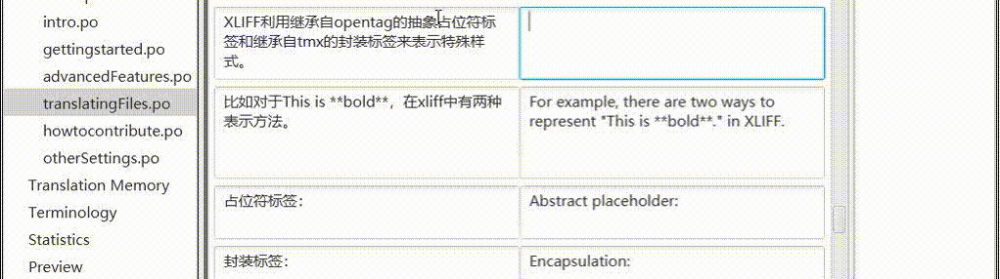
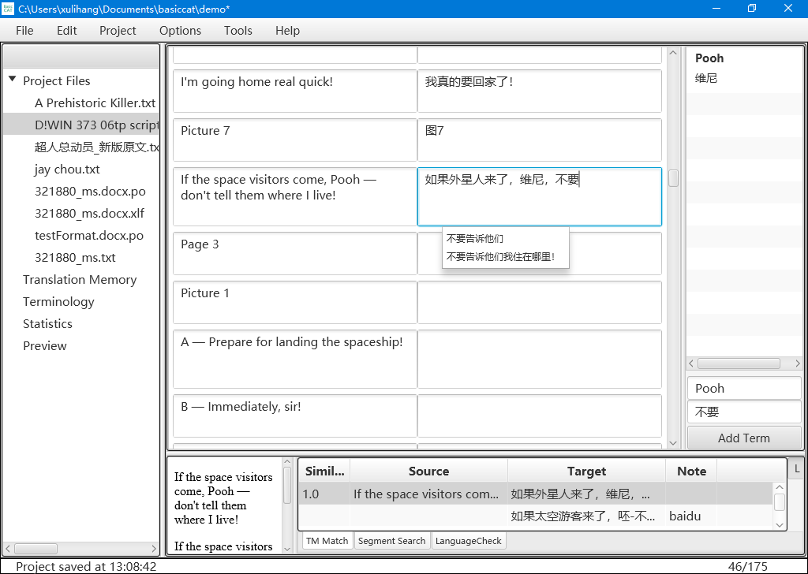

	<section class="site-header">
		<h1 class="smallcap"><a class="site-title" href="{{ '/' | prepend: site.baseurl | prepend: site.url }}">BasicCAT</a></h1>
		
		
	</section>

BasicCAT là phần mềm dịch có hỗ trợ máy tính miễn phí và mã nguồn mở, ra đời nhằm mang đến cho người dịch một công cụ dịch đơn giản và thực dụng. Tên BasicCAT có hai lý do: thứ nhất, vì nó đơn giản, dễ dùng; thứ hai, vì nó được viết bằng ngôn ngữ Basic, nên bất kỳ ai sau một thời gian học cũng có thể nắm được và tạo ra, từ mã nguồn của BasicCAT, một phần mềm phù hợp với nhu cầu của chính mình.

Nguyên tắc thiết kế của BasicCAT là giảm tối đa việc di chuyển ánh nhìn của người dịch, giúp họ tập trung vào việc biên tập bản dịch. Dịch máy, tra cứu thuật ngữ khi bôi đen và lỗi chính tả đều hiển thị dưới dạng danh sách thả xuống bên dưới ô nhập.

{: width="1022" height="286"}

BasicCAT có các tính năng sau, giúp người dịch hoàn thành công việc dịch thuật một cách nhẹ nhàng:

* Bộ nhớ dịch
* Quản lý thuật ngữ
* Kiểm tra ngôn ngữ
* Tra cứu thuật ngữ khi bôi đen
* Điền nhanh
* Tự động sửa lỗi
* Dịch máy tương tác
* Xuất sang Word để hiệu đính bên ngoài
* Xuất tệp đoạn song ngữ đối chiếu
* Tách và gộp phân đoạn
* Tra cứu nhiều từ điển trực tuyến
* Gọi API của các dịch vụ dịch máy phổ biến
* Hỗ trợ dịch trước toàn văn bằng bộ nhớ dịch và dịch máy
* Hỗ trợ các định dạng tệp nguồn phổ biến: txt, idml, xliff, gettext po
* Hỗ trợ tiêu chuẩn bộ nhớ dịch TMX, quản lý thuật ngữ TBX và tách câu SRX
* Quản lý phiên bản bằng Git

Liên kết:

* [Tải xuống](https://www.basiccat.org/vi/download)
* [Ghi chú phát hành](https://www.basiccat.org/vi/releasenote)
* [Tài liệu](https://docs.basiccat.org/en/latest/)

Nếu bạn cần dịch truyện tranh hoặc hình ảnh, hãy dùng [ImageTrans](/vi/imagetrans/).

Nếu bạn cần dịch video và âm thanh, hãy dùng [Silhouette](/vi/silhouette/).

Xem thêm sản phẩm tại [danh sách sản phẩm](/vi/products/).

{: width="1024" height="728"}
