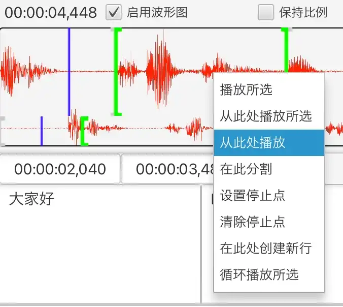
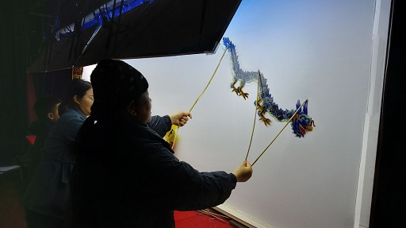

Silhouette là phần mềm dịch video và âm thanh có hỗ trợ máy tính.

{: width="1500" height="1160"}

## Tính năng

1. Nhận dạng giọng nói và phát hiện hoạt động giọng nói được điều khiển bởi AI. Sử dụng các mô hình trí tuệ nhân tạo như OpenAI Whisper, Qwen3-ASR. Hỗ trợ nhiều ngôn ngữ như tiếng Anh, tiếng Trung, tiếng Nhật, tiếng Quảng Đông. Hỗ trợ nhiều phương ngữ Trung Quốc như tiếng Thượng Hải, tiếng Mân Nam.
2. Dịch máy được điều khiển bởi AI, tính đến ngữ cảnh một cách đầy đủ. Hỗ trợ gọi ChatGPT, DeepSeek.
3. Giao diện dễ sử dụng, hỗ trợ hiển thị dạng sóng âm, có nhiều chức năng điều khiển phát, có thể điều chỉnh phụ đề một cách thuận tiện.

   {: width="676" height="604"}
4. Đa nền tảng. Hỗ trợ Windows, macOS và Linux.
5. Nhập và xuất tệp phụ đề (SRT, TXT hoặc XLIFF).
6. Hỗ trợ căn chỉnh dòng thời gian đã nhận dạng với văn bản có sẵn ([căn chỉnh văn bản và âm thanh](/vi/align-text-with-audio/)).

## Tải xuống

* [Windows (x86_64)](https://github.com/xulihang/Silhouette/releases/download/v1.6.2/Silhouette-windows-x64.zip)
* [macOS (Apple CPU)](https://github.com/xulihang/Silhouette/releases/download/v1.6.2/Silhouette-mac-arm.dmg)
* [macOS (Intel CPU)](https://github.com/xulihang/Silhouette/releases/download/v1.6.2/Silhouette-mac-x64.dmg)
* [Linux](/vi/silhouette/docs/#cài-đặt)

[Tải xuống từ ổ đĩa đám mây](https://pan.quark.cn/s/0eefc3296abc)

## Mua

Mua Silhouette trên nền tảng của bên thứ ba để mở khóa toàn bộ chức năng của phần mềm:

* [MbD](https://mbd.pub/o/bread/Z56WlpZv)
* [FastSpring (người dùng nước ngoài)](https://basiccat.onfastspring.com/silhouette)

Lưu ý: Mặc định có 7 ngày dùng thử. Sau khi hết thời gian dùng thử, các chức năng sẽ bị hạn chế, có giới hạn đối với độ dài phương tiện, dạng sóng âm và tính năng nhập.

## Thêm

* [Tài liệu](/vi/silhouette/docs/)
* [Nhật ký phát hành](/vi/silhouette/release-notes/)
* [Hỗ trợ kỹ thuật](/vi/support/)
* [Video](/vi/silhouette/video/)

## Nguồn gốc của cái tên

Rối bóng ở quê tôi Hải Ninh, tên tiếng Anh là leather-silhouette show, có thể xem như một hình thức sơ khai của điện ảnh. Ở đây lấy từ silhouette để đặt tên cho phần mềm.

{: width="512" height="287"}



